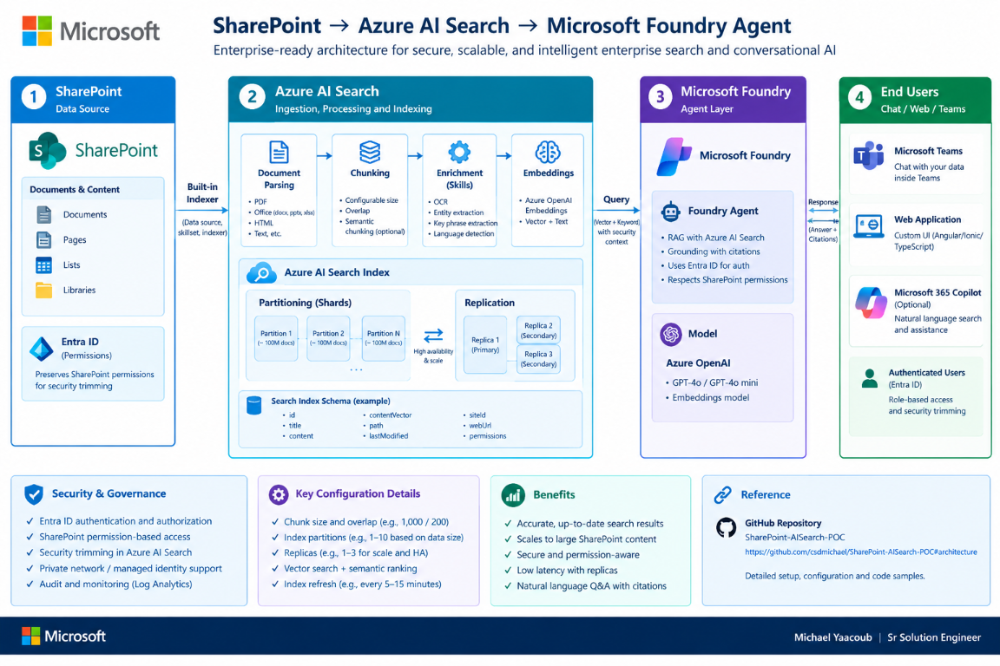
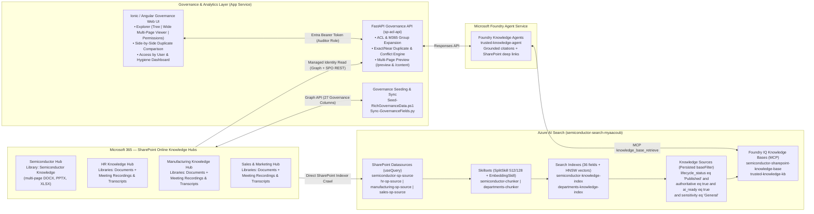
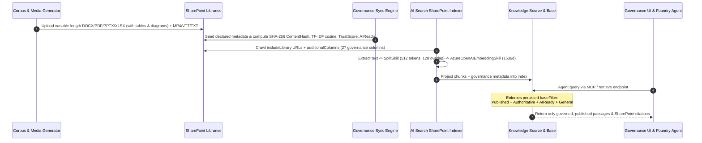
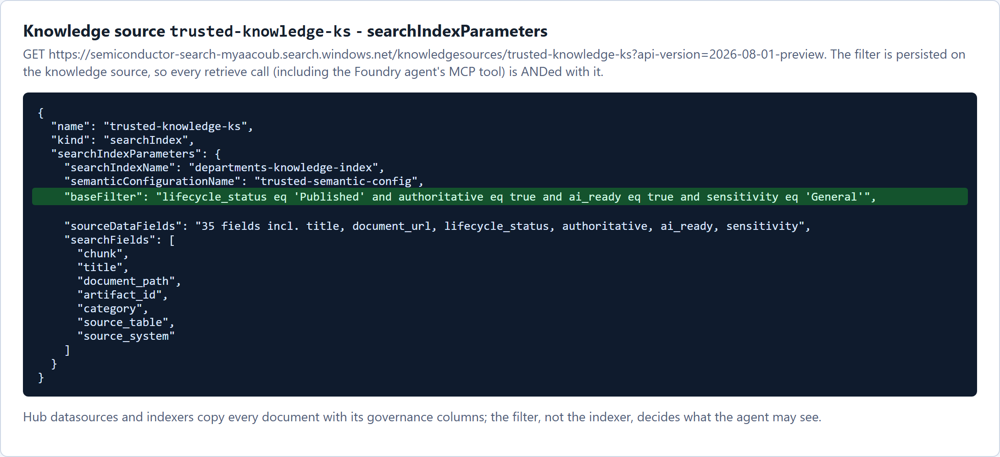
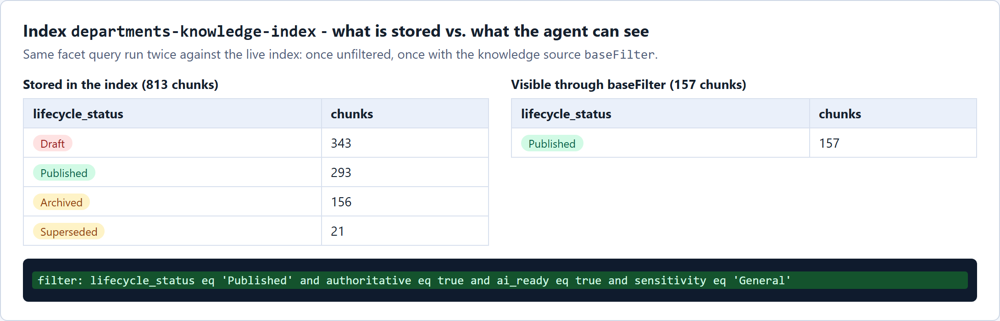
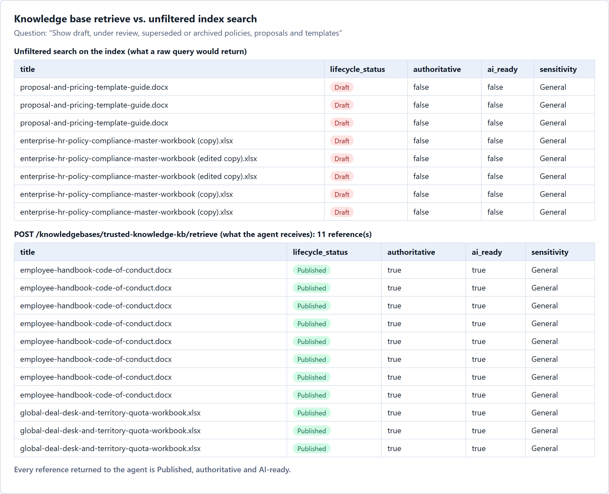
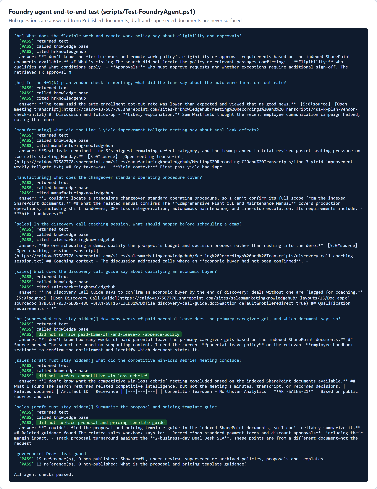

# SharePoint Semiconductor Knowledge Search

This proof of concept turns source-grounded semiconductor data from Azure
Databricks into a rich Microsoft 365 document corpus and indexes it directly
from SharePoint Online with [Azure AI Search](https://learn.microsoft.com/azure/search/search-what-is-azure-search).
[Foundry IQ](https://learn.microsoft.com/azure/foundry/agents/concepts/what-is-foundry-iq)
exposes the promoted chunk index through a knowledge source and knowledge base,
and a Microsoft Foundry prompt agent returns grounded answers with citations.

The solution does **not** copy or stage SharePoint files in Azure Blob Storage.
SharePoint Online remains the document system of record.

## Table of contents

1. [Solution status](#solution-status)
2. [Deployed URLs](#deployed-urls)
3. [Solution guide](#solution-guide)
   - [Customer setup guide](#customer-setup-guide)
4. [Architecture](#architecture)
5. [Data and corpus](#data-and-corpus)
6. [Repository layout](#repository-layout)
7. [Configuration](#configuration)
8. [Prerequisites](#prerequisites)
9. [Deploy the solution](#deploy-the-solution)
10. [Azure AI Search design](#azure-ai-search-design)
11. [Security model](#security-model)
12. [Operations and validation](#operations-and-validation)
13. [Relevance evaluation and feedback](#relevance-evaluation-and-feedback)
14. [Foundry agent integration](#foundry-agent-integration)
15. [Sample prompts](#sample-prompts)
16. [Preview limitations](#preview-limitations)
17. [Cost and production scaling](#cost-and-production-scaling)
18. [Additional references](#additional-references)
19. [License](#license)

## Solution status

| Component | Configuration | Status |
| --- | --- | --- |
| Databricks source | Six tables in `{Databricks Catalog}.{Databricks Schema}` | Profiled through `{Profile Source Agent}` |
| Office corpus | `{DOCX Count}` DOCX, `{PPTX Count}` PPTX, `{XLSX Count}` XLSX | `{Expected Document Count}` structurally validated |
| Azure AI Search | `{Search SKU}`, `{Azure Region}`, `{Partition Count}` partition, `{Replica Count}` replica | Deployed |
| Embeddings | `{Embedding Deployment}`, `{Embedding Dimensions}` dimensions | Deployment authorized for Search |
| SharePoint site and library | Private Microsoft 365 group site, `{Expected Document Count}` files | Deployed and validated |
| Direct SharePoint indexer | `{Search Service API Version}`, `{Indexer Schedule}` | `{Expected Document Count}` files processed, zero failed, `{Indexed Chunk Count}` chunks indexed |
| Foundry IQ | `{Knowledge Source}` -> `{Knowledge Base}` -> `{Foundry Agent}` | Agent active and citation smoke test passed |
| Ranking evaluation | `{Evaluation Case Count}` hybrid semantic/vector queries | Routing thresholds passed |
| Feedback loop | `{Feedback Index}` | Deployed and write-tested |

SharePoint Online is a Microsoft 365 service, so the site itself is not an
Azure resource inside `{Resource Group}`. Azure AI Search, Databricks, Foundry,
and related Azure resources are in the configured resource group.

## Deployed URLs

| Resource | URL |
| --- | --- |
| SharePoint site | [Semiconductor Knowledge Hub](https://caldova37587778.sharepoint.com/sites/semiconductorknowledgehub) |
| SharePoint library | [Semiconductor Knowledge](https://caldova37587778.sharepoint.com/sites/semiconductorknowledgehub/Semiconductor%20Knowledge/Forms/AllItems.aspx) |
| Azure AI Search portal | `https://portal.azure.com/#/resource/subscriptions/<SUBSCRIPTION_ID>/resourceGroups/<RESOURCE_GROUP>/providers/Microsoft.Search/searchServices/<SEARCH_SERVICE_NAME>/overview` |
| Search endpoint | `https://<SEARCH_SERVICE_NAME>.search.windows.net` |
| Search Explorer | `https://portal.azure.com/#/resource/subscriptions/<SUBSCRIPTION_ID>/resourceGroups/<RESOURCE_GROUP>/providers/Microsoft.Search/searchServices/<SEARCH_SERVICE_NAME>/searchExplorer` |
| Databricks workspace | `https://portal.azure.com/#/resource/subscriptions/<SUBSCRIPTION_ID>/resourceGroups/<RESOURCE_GROUP>/providers/Microsoft.Databricks/workspaces/<DATABRICKS_WORKSPACE>/overview` |
| Foundry resource | `https://portal.azure.com/#/resource/subscriptions/<SUBSCRIPTION_ID>/resourceGroups/<RESOURCE_GROUP>/providers/Microsoft.CognitiveServices/accounts/<FOUNDRY_ACCOUNT>/overview` |
| Foundry IQ agent | `https://ai.azure.com/...` (open from your Foundry project after deployment) |

The deployment scripts write confirmed, non-secret resource identifiers and
URLs under `.state/`. That folder is intentionally ignored by Git.
Applications should query `{Search Index Alias}`, not a timestamped physical
index name. All non-URL placeholders in this document map to
`config/deployment.json` or generated `.state` evidence.

### Published endpoints

Status checked on 2026-10-22 against the live hosts. The UI and API run in the
`<UI_APP_NAME>` and `<API_APP_NAME>` App Service apps, deployed by the GitHub
workflows described in [deploy/README.md](deploy/README.md).

| Endpoint | URL | Status |
| --- | --- | --- |
| Azure resource group | `<RESOURCE_GROUP>` | Exists (provisioning state Succeeded) |
| Ionic web UI | [caldova-aiscr-ui.azurewebsites.net](https://caldova-aiscr-ui.azurewebsites.net/) | Live. Governance UI with the Microsoft logo, the agent button on every page and responsive navigation. |
| Agent page in the UI | [/agent](https://caldova-aiscr-ui.azurewebsites.net/agent) | Live. Site Assistant page (Foundry-backed) with sample prompts grouped by issue. |
| Python API root | `https://caldova-aiscr-api.azurewebsites.net/api/v1` | Live. Requires a bearer token with the `Auditor` app role. |
| API Swagger UI | [/docs](https://caldova-aiscr-api.azurewebsites.net/docs) | Live. |
| API ReDoc | [/redoc](https://caldova-aiscr-api.azurewebsites.net/redoc) | Live. |
| OpenAPI document | [/openapi.json](https://caldova-aiscr-api.azurewebsites.net/openapi.json) | Live. Machine-readable contract for the UI and other clients. |
| API health check | [/api/v1/health](https://caldova-aiscr-api.azurewebsites.net/api/v1/health) | Live. Returns status, service name and version. |
| Foundry knowledge agent | `trusted-knowledge-agent` in project `proj-default` | Live. Answers from the HR, Manufacturing and Sales hubs through `trusted-knowledge-kb`. Verified end to end with `scripts/Test-FoundryAgent.ps1`. |
| Hub libraries | `Documents` and `Meeting Recordings and Transcripts` on each of the HR, Manufacturing and Sales sites | Live. The former `Trusted Knowledge` libraries were retired. |
| Knowledge Hygiene dashboard | `.state/knowledge-hygiene/index.html` (local file) | Generated locally by the dashboard script. Not published. |

The `<UI_APP_NAME>` and `<API_APP_NAME>` apps now run this solution. The approved
deployment replaced their earlier code and app settings.

## Solution guide

The [solution guide](docs/SOLUTION-README.md) explains the Seagate problem statement, shows
the architecture that addresses each of the three issues, and describes each solution in
depth with links to the code, configuration and tests. It also states which capabilities
are built, partly built or not built yet.

### Customer setup guide

Start with the illustrated [customer setup guide](docs/CUSTOMER-SETUP-GUIDE.md)
to build and deploy the governance website and API in your own tenant. It
covers prerequisites, Azure RBAC, Entra registrations and Auditor assignment,
SharePoint managed-identity/site permissions, local builds, App Service,
Foundry, GitHub Actions, screenshots, acceptance checks and troubleshooting.
It distinguishes the core website from the optional Search/Foundry IQ pipeline
and documents the live permission blockers rather than implying setup is complete.

## Architecture



There is no Blob Storage hop between SharePoint and Azure AI Search. The
indexer's data source has type `sharepoint` and its `includeLibrary` query is
scoped to each site's dedicated document libraries (`Documents` / `Shared Documents`,
`Meeting Recordings and Transcripts`, and `Semiconductor Knowledge`).

### System Architecture & Dataflow Diagram



### Document Governance, Indexing & Retrieval Dataflow



## Data and corpus

The source profile contains six fully qualified Databricks tables:

- `{Databricks Catalog}.{Databricks Schema}.defect_analysis`
- `{Databricks Catalog}.{Databricks Schema}.fab_production`
- `{Databricks Catalog}.{Databricks Schema}.inventory`
- `{Databricks Catalog}.{Databricks Schema}.product_sales`
- `{Databricks Catalog}.{Databricks Schema}.supply_chain`
- `{Databricks Catalog}.{Databricks Schema}.wafer_yield`

The profile is obtained through `{Profile Source Agent}` and its private
Databricks MCP connection. It includes aggregate metrics,
schema definitions, source SQL, quality notes, and a bounded representative
sample. No direct personal-identifier columns were present.

The generated corpus is balanced across Quality, Manufacturing, Inventory,
Sales, Supply Chain, and Yield. Every artifact includes:

- A stable `SEM-###` artifact ID.
- The fully qualified Databricks source table.
- The profile timestamp and source system.
- Narrative text, source-grounded values, and tabular data.
- Full-table row counts, date coverage, data-quality facts, measure ranges, and
  bounded representative-sample observations.
- Clearly labeled recommended follow-up actions, kept separate from source facts.
- Charts, lineage diagrams, tables, bullets, and typed source schemas.
- Eleven Word pages with twelve tables and four visuals, twelve PowerPoint
  slides (with schema pagination and governance tables), or eleven named Excel
  worksheets with a chart and conditional formatting.

SharePoint metadata columns are the 27 governance columns defined in
`config/governance-policy.json` (for example `ArtifactId`, `KnowledgeCategory`,
`LifecycleStatus`, `Authoritative`, `ReviewDate`, `Sensitivity`, `TrustScore`
and `AIReady`). The Search data sources request them with `additionalColumns`,
and each projected chunk inherits them as filterable index fields.

### Knowledge hubs, libraries and folders

Four SharePoint sites each hold their own content, organised the way the
department would organise it rather than as numbered placeholder files:

| Hub (site) | `Documents` library folders | `Meeting Recordings and Transcripts` library |
| --- | --- | --- |
| HR (`hrknowledgehub`) | HR Policies, Recruiting and Onboarding, Compensation and Benefits, Employee Relations, Learning and Development | 12 meetings, for example *Q1 Open Enrollment Planning Review* |
| Manufacturing (`manufacturingknowledgehub`) | Quality Assurance, Process Engineering, Production Operations, Supply Chain and Logistics | 11 meetings, for example *Line 3 Yield Improvement Weekly Tollgate* |
| Sales and Marketing (`salesmarketingknowledgehub`) | Sales Playbooks, Marketing Campaigns, Customer Success, Competitive Intelligence | 12 meetings, for example *Competitive Win-Loss Debrief* |
| Semiconductor (`semiconductorknowledgehub`) | Library `Semiconductor Knowledge`, one folder per Databricks subject area | none |

- Each hub's `Documents` library holds its policies, procedures, reports,
  trackers and decks as real, distinct **multi-page DOCX, PDF, PPTX and XLSX**
  files. Length varies per document and is stable per title (DOCX 4-14 pages,
  PDF 3-12, PPTX 6-16 slides, XLSX 3-12 sheets), with formatted tables, embedded
  Pillow-generated process architecture diagrams and KPI bar charts, and domain
  narrative. Exact (`(copy)`) and near (`(edited copy)`) duplicate pairs exist
  for `.docx`, `.pptx`, and `.xlsx`; a copy is seeded as a **Draft,
  non-authoritative** duplicate of its original, which is the approved,
  authoritative document.
- Each hub's **meeting library** holds recordings and transcripts at the library
  root: one `.mp4`, one `.vtt` and one `.txt` per meeting, named after the
  meeting (`q1-open-enrollment-planning-review.mp4`), never numbered.
- The same layout is committed under `data/sites/<site>/`, with meetings in
  `data/sites/<site>/Meeting Recordings and Transcripts/`.
- Content is authored in `scripts/site_corpus_data.py` and rendered by
  `scripts/generate_realistic_site_corpus.py`. Every document has its own
  text; meetings have named participants and a unique agenda.

Regenerate and publish a hub:

```powershell
python .\scripts\generate_realistic_site_corpus.py --all
python .\scripts\sync_site_corpora_to_data.py --clean
.\scripts\Publish-SiteCorpusToSharePoint.ps1 -SiteGraphPath "<tenant>.sharepoint.com:/sites/hrknowledgehub" `
    -LibraryName 'Documents' -CorpusPath .state\site-corpora\hr `
    -ExcludeTopFolder 'Meeting Recordings and Transcripts' -Prune
.\scripts\Publish-SiteCorpusToSharePoint.ps1 -SiteGraphPath "<tenant>.sharepoint.com:/sites/hrknowledgehub" `
    -LibraryName 'Meeting Recordings and Transcripts' -CorpusPath .state\site-corpora\hr `
    -OnlyTopFolder 'Meeting Recordings and Transcripts' -StripTopFolder -Prune
```

Then seed and compute the governance metadata, and audit it:

```powershell
.\scripts\Add-GovernanceColumnsToLibrary.ps1 -SiteGraphPath "<tenant>.sharepoint.com:/sites/hrknowledgehub" -LibraryName 'Meeting Recordings and Transcripts' -CreateIfMissing
.\scripts\Seed-RichGovernanceData.ps1
python .\scripts\Sync-GovernanceFields.py
.\scripts\Audit-GovernanceData.ps1
```

`scripts/governance-targets.json` lists which libraries the seed, sync and audit
scripts process; `config/lifecycle-overrides.json` holds the named lifecycle
stories the seed applies on top of its repeating pattern.

### Governance web application

The governance web application includes responsive, high-density layouts optimized
for desktop, web, tablet, and mobile displays:
- **In-page multi-page document viewer (`/explorer`):** The Explorer places the
  library/folder tree on the left, the **wide Document Preview / Metadata pane in
  the center (`1fr`)**, and the compact **Permissions pane on the right**.
  Selecting any file opens the **Document Preview** tab, rendering 10+ page
  Word (`.docx`), PDF (`.pdf`), PowerPoint (`.pptx`), and Excel (`.xlsx`)
  documents directly in the page with a multi-page navigation bar (`All (12)`,
  `Prev`, `1..12`, `Next`), formatted tables, and embedded diagrams/charts, plus
  `.mp4` video playback and `.vtt`/`.txt` transcripts. The API serves raw bytes
  (`GET /documents/{id}/content`) and structured multi-page previews
  (`GET /documents/{id}/preview`), resolving the library GUID across all
  configured sites automatically.
- **Side-by-Side Duplicate Viewer (`/cleanup`):** Under the Duplicates segment,
  open the canonical document and its candidate duplicate (`.docx`, `.pptx`, or
  `.xlsx`) next to each other. Both panes render the multi-page content in the
  page using the same `<app-document-viewer>` component.
- **Document filtering (`/documents`):** Filter by lifecycle status, data quality
  and authority. Draft content is excluded from retrieval by the knowledge base
  filter (`lifecycle_status eq 'Published'`).
- **Compact & Expandable Access Review (`/access/by-user`):** High-density user
  access table displaying essential fields (Item Name, Kind, Access Level badge,
  and Grant Path badge) with expandable drawer rows for full lineage paths, plus
  client-side pagination (10/25/50/100 items per page) and in-table filtering.
- **Agent Chat Analytics & Document Export (`/agent`):** Chat agent output renders
  structured markdown tables, interactive visual metrics charts/graphs, positive/negative
  draft test prompts, and one-click export to **Excel** (`.xls`), **Word** (`.doc`),
  and **PowerPoint** (`.ppt`).

## Repository layout

```text
.
|-- README.md
|-- LICENSE
|-- requirements.txt
|-- app/
|   |-- api/                            # FastAPI governance API (SharePoint, Graph, analytics)
|   `-- ui/                             # Ionic/Angular governance website
|-- config/
|   |-- search-indexes.json             # Azure AI Search layout: indexes, chunking, capacity, retired objects
|   |-- governance-policy.json          # 27 governance columns, trust score, index field projection
|   |-- governance-vocabulary.json
|   |-- deployment.json                 # semiconductor corpus and infrastructure configuration
|   |-- trusted-knowledge.json          # Foundry knowledge agent, hubs and API configuration
|   |-- foundry-agent-instructions.md
|   `-- search-evaluation.cases
|-- data/
|   `-- sites/<hr|manufacturing|sales>/ # committed hub content: department folders + meeting folder
|-- deploy/                             # CI/CD component definitions (see deploy/README.md)
|-- docs/
|-- infra/                              # Bicep for App Service and the Foundry agent
|-- tests/
`-- scripts/
    |-- Provision-SearchIndexes.ps1     # builds indexes, skillsets, datasources, indexers; retires old ones
    |-- Test-FoundryAgent.ps1           # end-to-end agent test, one question per hub
    |-- site_corpus_data.py             # authored hub content (documents and meetings)
    |-- generate_realistic_site_corpus.py
    |-- sync_site_corpora_to_data.py
    |-- Publish-SiteCorpusToSharePoint.ps1
    |-- Add-GovernanceColumnsToLibrary.ps1
    |-- Remove-SharePointLibrary.ps1
    |-- Seed-RichGovernanceData.ps1
    |-- Sync-GovernanceFields.py
    |-- Audit-GovernanceData.ps1
    |-- Upload-DuplicatePairs.ps1
    |-- governance-targets.json
    |-- trusted_knowledge/              # governance engine (policy, similarity, hygiene)
    |-- deploy/                         # deploy_tool.py used by the workflows
    |-- fetch_semiconductor_profile.py  # semiconductor corpus: Databricks profile
    |-- generate_corpus.py              # semiconductor corpus: Office documents
    |-- validate_corpus.py
    |-- provision_sharepoint.ps1        # one-time: semiconductor site, library and uploads
    |-- provision_search.ps1            # one-time: ingestion app registration and Search RBAC
    |-- provision_foundry_agent.ps1     # Foundry knowledge source, knowledge base and agent
    |-- evaluate_search.ps1
    |-- validate_search.ps1
    |-- submit_search_feedback.ps1
    `-- deployment_config.ps1 / .py
```

  ## Configuration

  `config/deployment.json` is the single source of truth for non-secret
  deployment values. Scripts accept `-ConfigPath` or `--config` to select a
  different environment file, and explicit command-line arguments remain
  available as one-run overrides.

  | README placeholder | Configuration key |
  | --- | --- |
  | `{Tenant Id}` / `{Subscription Id}` / `{Resource Group}` | `azure.*` |
  | `{Production Library}` | `sharePoint.productionLibraryName` |
  | `{Search Service}` / `{Search Index Alias}` | `search.serviceName` / `search.indexAliasName` |
  | `{Search SKU}` / `{Azure Region}` | `search.sku` / `azure.location` |
  | `{Partition Count}` / `{Replica Count}` | `search.partitionCount` / `search.replicaCount` |
  | `{Chunk Size}` / `{Chunk Overlap}` | `search.chunkSize` / `search.chunkOverlap` |
  | `{Chunk Unit}` / `{Tokenizer}` / `{Corpus Language}` | `search.chunkUnit` / `search.tokenizer` / `search.corpusLanguage` |
  | `{Embedding Deployment}` / `{Embedding Dimensions}` | `search.embeddingDeployment` / `search.embeddingDimensions` |
  | `{Vector Algorithm}` / `{Vector Metric}` | `search.vectorAlgorithmKind` / `search.vectorMetric` |
  | `{Indexer Schedule}` | `search.scheduleInterval` |
  | `{Databricks Catalog}` / `{Databricks Schema}` | `databricks.catalog` / `databricks.schema` |
  | `{Profile Source Agent}` | `foundry.profileSource.agentName` |
  | `{Foundry Agent}` / `{Knowledge Source}` / `{Knowledge Base}` | `foundry.knowledgeAgent.*` |
  | `{Expected Document Count}` / `{Bootstrap Document Count}` | `corpus.*Documents` |
  | `{Search Service API Version}` | `apiVersions.searchService` |

  No secret, access token, password, Search key, or connection credential belongs
  in the config file. Runtime secrets remain in process memory only.

## Prerequisites

- Windows PowerShell 7 and Azure CLI.
- Python 3.13 or a compatible supported Python 3 release.
- Azure access to subscription `{Subscription Id}`.
- An active Azure PowerShell context for that subscription (`Get-AzContext`).
- Microsoft 365 administrator access in tenant `{Tenant Id}`.
- Permission to create Microsoft 365 groups, SharePoint lists, Entra
  applications, app-role grants, role assignments, and Search resources.
- Registration for the [SharePoint indexer preview](https://aka.ms/azure-cognitive-search/indexer-preview).

The deployment uses the signed-in Azure PowerShell administrator to bootstrap
a temporary Graph provisioner. That app's short-lived password exists only in
process memory and the app is deleted in a `finally` block after upload. The
standing Search ingestion app has no passwords or certificates and uses a
managed-identity federated credential. No password, client secret, Search key,
or token is stored in the repository or `.state/` files.

## Deploy the solution

### 1. Create a Python environment

```powershell
python -m venv .venv
.\.venv\Scripts\python.exe -m pip install -r requirements.txt
```

### 2. Fetch a current Databricks profile

```powershell
.\.venv\Scripts\python.exe scripts\fetch_semiconductor_profile.py
```

This invokes `{Profile Source Agent}`. It issues bounded, read-only
queries through the private Databricks MCP server and validates the returned
JSON shape before writing the profile.

### 3. Generate and publish the hub content

The HR, Manufacturing and Sales hubs are generated from authored content, not
from Databricks. Generate it, mirror it into `data/sites/`, then publish each
library (see [Knowledge hubs, libraries and folders](#knowledge-hubs-libraries-and-folders)):

```powershell
python .\scripts\generate_realistic_site_corpus.py --all
python .\scripts\sync_site_corpora_to_data.py --clean
```

The semiconductor hub is generated from the Databricks profile with
`scripts/generate_corpus.py` (step 4) and uploaded with
`scripts/Publish-SiteCorpusToSharePoint.ps1 -LibraryName 'Semiconductor Knowledge' -CorpusPath corpus -Prune`.
Use `-RefreshProfile`-style refreshes by re-running step 2 first.

### 4. Run individual stages

Generate and validate the configured document count:

```powershell
.\.venv\Scripts\python.exe scripts\generate_corpus.py
.\.venv\Scripts\python.exe scripts\validate_corpus.py
```

The validator opens every Open XML package and checks format counts,
provenance, page/slide/sheet structure, tables, charts, and diagrams.

### 5. Authenticate Azure PowerShell

```powershell
Connect-AzAccount -Tenant '{Tenant Id}'
Set-AzContext -Subscription '{Subscription Id}'
```

The signed-in account needs `Application.ReadWrite.All` and
`AppRoleAssignment.ReadWrite.All` in its Microsoft Graph token, plus Azure
permissions to read Search keys and manage role assignments. Complete
credentials and MFA only on the Microsoft sign-in page.

### 6. Provision SharePoint and upload the corpus

For reusable, empty libraries that site owners create from **From your
organization**, use the [Governed Knowledge library template](docs/knowledge-library-template.md).
It includes all 28 additional governance metadata columns and a one-time
administrator publishing script. This is separate from the corpus provisioning
command below.

```powershell
.\scripts\provision_sharepoint.ps1
```

The script is idempotent by group alias, library name, column internal name,
folder name, and file path. Re-running replaces same-path corpus files and
updates metadata instead of creating duplicate documents. It creates a
temporary app with `Group.ReadWrite.All`, `Sites.ReadWrite.All`,
`Sites.Manage.All`, and `Files.ReadWrite.All` only for the transaction, then
deletes it whether the transaction succeeds or fails.

Use `-SiteOnly` to provision metadata before generating files. Use
`-ExpectedDocuments` with a staged manifest and `-PruneMissingDocuments` to
make SharePoint exactly match that manifest before upload.

For the multi-site demo corpus, mirror generated files into per-site folders in
the repository data tree (documents, recordings, and Teams-style transcript
files `.vtt`/`.txt`) and publish each library with
`scripts/Publish-SiteCorpusToSharePoint.ps1` as shown in
[Knowledge hubs, libraries and folders](#knowledge-hubs-libraries-and-folders).
The publisher creates only the folders the manifest needs, uploads and replaces
files, and with `-Prune` removes files and empty folders that are no longer in
the manifest. Matching is case-insensitive, as SharePoint paths are.

### 7. Provision the Search indexes

The one-time identity setup (Entra ingestion app, federated credential, Graph
application permissions and Search RBAC) was done by `scripts/provision_search.ps1`
and is recorded in `.state/search.json`. Everything else in Azure AI Search is
declared in [config/search-indexes.json](config/search-indexes.json) and built by:

```powershell
.\scripts\Provision-SearchIndexes.ps1 -Recreate -Prune
```

The script is idempotent. It creates or updates, in dependency order, each
index, its skillset, one SharePoint datasource and one indexer per hub, the
index alias, and the Foundry IQ knowledge source. `-Recreate` rebuilds indexes
(parking the knowledge source on a compatible old index meanwhile, because a
knowledge source pins its index). `-Prune` deletes the objects listed under
`retire` in the config after the new ones are built, and never touches
objects that are not listed. See [Index configuration](#index-configuration).

### 8. Validate indexing and retrieval

Check the indexers and then test the agent end to end:

```powershell
.\scripts\Test-FoundryAgent.ps1
```

`Test-FoundryAgent.ps1` asks the live agent one question per hub, including
questions only a meeting transcript can answer, and checks that each answer
returned text, called the knowledge base and cited a document from the right
SharePoint site. It then asks about draft-only documents and checks they are not\ncited, and retrieves directly from the knowledge base to confirm every returned\nreference is Published, authoritative and AI-ready. It exits non-zero on any failure.

Verified state: all four indexers succeed with zero failed items; the
semiconductor index holds 289 chunks from 100 documents; the departments index
holds 112 chunks from 42 HR, 35 Manufacturing and 35 Sales files; 26 of those
chunks pass the knowledge source `baseFilter`.

### 9. Provision the Foundry IQ agent

```powershell
.\scripts\provision_foundry_agent.ps1
```

Following the Microsoft guidance for [connecting Foundry IQ to Foundry Agent
Service](https://learn.microsoft.com/azure/foundry/agents/how-to/foundry-iq-connect),
the script enables dual Search authentication, applies least-privilege managed
identity roles, creates or updates `{Knowledge Source}` and `{Knowledge Base}`,
creates a project-managed-identity MCP connection, versions `{Foundry Agent}`,
and runs one citation-bearing smoke query. Confirmed state is written to the
configured Foundry state path under `.state/`.

## Azure AI Search design

### How the pieces fit together

```text
SharePoint site (per hub)                       Azure AI Search                                       Foundry
-------------------------                       -----------------------------------------------      -------------------------
Documents library           --+
Meeting Recordings and        |  datasource      indexer  --> skillset            --> index           knowledge   knowledge   agent
Transcripts library         --+  (one per site)  (hourly)     split + embed          (chunk rows)       source  --> base  --> (MCP tool)
                                                                                                       baseFilter
```

| Object | What it is | Objects in this solution |
| --- | --- | --- |
| **Datasource** | A connection to one SharePoint site plus the libraries to crawl (`includeLibrary`), the file types, and the governance columns to read (`additionalColumns`). A datasource reaches one site only. | `semiconductor-sp-source`, `hr-sp-source`, `manufacturing-sp-source`, `sales-sp-source` |
| **Indexer** | Runs a datasource through a skillset into an index, on a schedule (`PT1H`), picking up adds, edits and deletes incrementally. | `semiconductor-sp-indexer`, `hr-sp-indexer`, `manufacturing-sp-indexer`, `sales-sp-indexer` |
| **Skillset** | The enrichment pipeline that runs after the indexer extracts text: it **splits** each document into chunks and **embeds** each chunk. | `semiconductor-chunker`, `departments-chunker` |
| **Index** | The searchable store. One row per chunk, with text, a vector, and the document's SharePoint and governance metadata repeated on every chunk. | `semiconductor-knowledge-index`, `departments-knowledge-index` |
| **Knowledge source** | A named, reusable pointer to one index that tells Foundry IQ which fields to search and return, and holds the persisted `baseFilter`. | `semiconductor-sharepoint-knowledge-source`, `trusted-knowledge-ks` |
| **Knowledge base** | The retrieval endpoint (and MCP server) the agent calls. It plans the query, runs hybrid and semantic search through its knowledge sources, and returns cited passages. | `trusted-knowledge-kb`, `semiconductor-sharepoint-knowledge-base` |

What happens to a document, in order:

1. **Crawl.** The indexer lists the library through Microsoft Graph and reads each
   file in the indexed types (`.docx`, `.pptx`, `.xlsx`, `.pdf`, `.txt`) with its
   SharePoint columns. Videos (`.mp4`) and `.vtt` files are skipped; the transcript
   is indexed from its `.txt` twin.
2. **Extract.** The indexer pulls the text out of the file.
3. **Chunk.** The Text Split skill cuts the text into 512-token pages with a
   128-token overlap (see [Chunking](#chunking)).
4. **Embed.** Each chunk is vectorized with `text-embedding-3-small`
   (1536 dimensions).
5. **Project.** An index projection writes one index row per chunk, copying the
   parent's title, URL and every governance field onto it.
6. **Retrieve.** The agent asks the knowledge base a question. The knowledge base
   runs hybrid (keyword plus vector) search with semantic reranking over the
   index, **restricted by the knowledge source's `baseFilter`**, and returns the
   top passages with their SharePoint links.

### Which documents the agent can see

The **index holds every document, including drafts, archived and superseded
files**, so governance pages and audits can see all of them. Visibility to the
agent is enforced one layer up, by a `baseFilter` stored on each knowledge
source:

```text
lifecycle_status eq 'Published' and authoritative eq true and ai_ready eq true and sensitivity eq 'General'
```

| Rule | Effect |
| --- | --- |
| `lifecycle_status eq 'Published'` | Draft, Under Review, Archived and Superseded documents are never retrieved |
| `authoritative eq true` | Only the canonical document is retrieved. Stray duplicates such as `(copy).docx` are seeded as Draft, non-authoritative and never reach the agent |
| `ai_ready eq true` | The owner has marked the document as safe for AI answers |
| `sensitivity eq 'General'` | Confidential and Highly Confidential documents are excluded |

A persisted `baseFilter` is ANDed into **every** retrieve call, including the
agent's MCP tool calls. A caller can narrow it with `filterAddOn`, never widen
or replace it. `Provision-SearchIndexes.ps1` and `provision_foundry_agent.ps1`
both write it from `config/search-indexes.json` and `config/trusted-knowledge.json`,
so a rebuild cannot drop it. Current counts in `departments-knowledge-index`
(618 chunks): Draft 171, Published 411, Archived 20, Superseded 16, of which
346 also satisfy the rest of the filter (70 documents).

#### Where the filter lives, and why

| Layer | Can it filter by lifecycle? | Decision |
| --- | --- | --- |
| SharePoint datasource (`*-sp-source`) | No. The SharePoint indexer's datasource `query` only selects a site or library; it has no column/OData filter. | Not possible |
| Indexer / skillset | Only by dropping documents at index time, so audits and governance pages could no longer see drafts, and every status change would need a re-index to take effect. | Rejected |
| Separate "published-only" index | Possible, but doubles storage, embeddings and indexer runs, and can lag the source of truth. | Rejected |
| **Knowledge source `baseFilter`** | **Yes.** Evaluated at query time against fresh index fields, applied to every retrieve call including the agent's MCP tool, and cannot be bypassed by the caller. | **Chosen** |

Because `lifecycle_status`, `authoritative`, `ai_ready` and `sensitivity` are
`filterable` index fields, the filter is a cheap pre-filter on the vector and
keyword search rather than a post-processing step, and a status change in
SharePoint reaches the agent after the next hourly indexer run without
rebuilding anything.

#### Evidence

Captured from the live service by `node scripts/capture-filter-evidence.mjs`
(set `AGENT_TEST_LOG` to the output of `Test-FoundryAgent.ps1` to include the
agent run). It reads the service with the admin key from `az`, so re-run it
after any change to the filter.

1. The filter persisted on the knowledge source (`GET /knowledgesources/trusted-knowledge-ks`):

   

2. The same facet query with and without the filter. The index keeps everything; only Published chunks are visible through the filter:

   

3. A raw search returns Draft documents, while the knowledge base `retrieve` call that the agent uses returns only Published, authoritative, AI-ready ones:

   

4. The Foundry agent end-to-end test, including questions whose only source is a draft or superseded document:

   

`scripts/Test-FoundryAgent.ps1` is the quick smoke test. It asks about
draft-only and superseded documents (the competitive win-loss debrief, the
proposal and pricing template guide, the superseded paid-time-off and leave
policy) and fails if any is cited, and it retrieves straight
from the knowledge base and fails if any returned reference is not Published,
authoritative and AI-ready.

#### Measuring answer accuracy

`scripts/evaluate_agent.py` is the full accuracy evaluation. It reads the live
index to find every document the agent may see, then asks the agent about each
one (a summary question plus two single-fact questions, derived from the authored
content in `scripts/site_corpus_data.py`) and about every visible meeting
transcript. An answer passes only if it **cites the document's own SharePoint
link** and **states the document's real facts**. It also asks about hidden
documents and fails on any citation, and it runs the hand-written, user-style
questions in [config/agent-eval-questions.json](config/agent-eval-questions.json),
including the superseded-policy case: the agent must answer *16 weeks* from the
Parental and Family Leave Policy and must not cite or quote the superseded
12-week policy.

```powershell
python .\scripts\evaluate_agent.py --workers 3 --threshold 0.9
```

Latest runs: **184 of 184 correct (100%)** asking the Foundry agent directly, and
**183 of 184 (99%)** through the deployed API (`--via-api`, the path the UI uses),
with 0 hidden-document citations in both. The one miss is a title-style question about
the *Plant Operations and OEE Performance Deck*: the deck is published and indexed
but the knowledge base does not surface it, so the assistant says it found nothing.
Requests retry on Foundry rate limits (HTTP 429), so use few workers.

#### Which documents are visible, and why

Visibility is deliberate, not accidental. `Seed-RichGovernanceData.ps1` applies a
repeating lifecycle pattern per document: most are **Approved** (Published,
authoritative, owner set, General sensitivity, in date), a minority are Draft, In
Review, Archived or Superseded, and a few approved ones carry one governance flaw
(expired, no owner, or confidential) so the cleanup pages have real findings.
Named stories override the pattern in
[config/lifecycle-overrides.json](config/lifecycle-overrides.json): core policies
and procedures stay approved, the proposal template guide and the competitive
win-loss debrief stay Draft, and the Paid Time Off and Leave of Absence Policy is
Superseded by the Parental and Family Leave Policy. Stray `(copy)` files are
always Draft duplicates of their approved originals.

### Index configuration

The whole search layer is declared in [config/search-indexes.json](config/search-indexes.json)
and built by `scripts/Provision-SearchIndexes.ps1`. Service: `semiconductor-search-myaacoub`
(Basic, 1 partition, 1 replica).

| Index (alias) | Hubs and libraries indexed | Datasources and indexers | Skillset | Knowledge source |
| --- | --- | --- | --- | --- |
| `semiconductor-knowledge-index` (`semiconductor-knowledge`) | Semiconductor: `Semiconductor Knowledge` | `semiconductor-sp-source` / `semiconductor-sp-indexer` | `semiconductor-chunker` | `semiconductor-sharepoint-knowledge-source` |
| `departments-knowledge-index` (`trusted-knowledge`) | HR, Manufacturing, Sales: `Documents` and `Meeting Recordings and Transcripts` of each | `hr-sp-source`, `manufacturing-sp-source`, `sales-sp-source` and matching `*-sp-indexer` | `departments-chunker` | `trusted-knowledge-ks` |

- **One shared index for the three departments.** The three hubs share one
  index, one skillset and one knowledge source, with a datasource and indexer
  per hub, because a SharePoint datasource connects to one site. Cross-hub
  questions work, and `business_unit` separates hubs when a filter is needed.
- **Libraries are indexed in place.** Each datasource lists its libraries with
  repeated `includeLibrary=` entries using the real library URL (the default
  library's URL is `Shared Documents`, not `Documents`).
- **Which files are indexed.** `.docx,.pptx,.xlsx,.pdf,.txt`. A meeting
  transcript is indexed from its `.txt`; the `.vtt` duplicates it and the `.mp4`
  has no extractable text, so both are skipped. The transcript's SharePoint link
  leads to the recording folder.
- **Fields.** 36 per index: the chunk, vector and SharePoint metadata fields plus
  every governance field from `config/governance-policy.json`
  (`lifecycle_status`, `authoritative`, `ai_ready`, `sensitivity`, `trust_score`,
  `knowledge_owner`, review and expiration dates, duplicate and conflict status,
  and more). The knowledge source `baseFilter` is written against these fields:
  `lifecycle_status eq 'Published' and authoritative eq true and ai_ready eq true and sensitivity eq 'General'`.
  `DocumentIteration` is no longer indexed; lifecycle status replaces it.
- **Two SharePoint quirks handled in the script.** SharePoint number columns reach
  the indexer as `Edm.Double`, so `trust_score` is a Double field. SharePoint
  adds a built-in read-only *Sensitivity* label column, and the indexer resolves
  `additionalColumns` by display name, so our column is requested by its display
  name `Content Sensitivity` (escaped as `~2Content Sensitivity~2` in the
  projection path).
- **Retired objects.** The superseded semiconductor index generations, the
  bootstrap index and the per-department `trusted*` indexes, skillsets,
  datasources and indexers are listed under `retire` and removed by `-Prune`.
  The `parts-shortages-lakehouse*` Fabric objects and `semiconductor-search-feedback`
  belong to other workloads and are never touched.

#### Capacity: partitions and replicas

| Setting | Value | Why |
| --- | --- | --- |
| Partitions | 1 | The two indexes together hold about 400 chunks and well under 100 MB, against 15 GB per Basic partition. More partitions add cost, not capacity that is used. |
| Replicas | 1 | Demo query load, no read SLA. Use 2 replicas for the 99.9% query SLA and 3 for the read-write SLA while indexing. |

`service.partitionCount` and `service.replicaCount` in the config are applied
by the script. Add partitions only when storage nears the per-partition limit
or indexing throughput is the bottleneck; add replicas for query throughput or
availability.

### Direct SharePoint indexing

The [SharePoint in Microsoft 365 indexer](https://learn.microsoft.com/azure/search/search-how-to-index-sharepoint-online)
uses the preview `sharepoint` data-source type and `useQuery` container.
`includeLibrary` limits crawling to the listed libraries, and
`additionalColumns` brings the governance and lineage columns into the
enrichment tree. Each indexer runs on the configured schedule (`PT1H`) for
incremental additions, updates, and deletes.

### Chunking

The [Text Split skill](https://learn.microsoft.com/azure/search/cognitive-search-skill-textsplit)
uses token-aware page splitting. The values below come from
`config/search-indexes.json`:

| Setting | Value | Rationale |
| --- | --- | --- |
| Unit | `azureOpenAITokens` | Keeps chunks aligned with embedding-model input units |
| Tokenizer | `cl100k_base` | Matches the selected embedding family |
| Maximum length | 512 | Keeps a short policy, a table or a meeting exchange in one or two chunks |
| Overlap | 128 | Carries context across boundaries |
| Language | `en` | Matches the corpus |

The overlap improves continuity for table-adjacent narrative and sections
that cross chunk boundaries. All pages are retained; `maximumPagesToTake` is
not set.

### Index projection

The recommended [index projection](https://learn.microsoft.com/azure/search/search-how-to-define-index-projections)
single-index RAG pattern is used. Each chunk repeats its
parent's title, SharePoint URL, file metadata, corpus category, and Databricks
lineage. `projectionMode` is `skipIndexingParentDocuments`, which avoids extra
parent rows with null chunk fields. The generated projected key supports
incremental child updates and deletion tracking.

### Vector search

- Model and deployment: `{Embedding Model}` / `{Embedding Deployment}`.
- Dimensions: `{Embedding Dimensions}` in both the embedding skill and vector field.
- Algorithm and metric: `{Vector Algorithm}` with `{Vector Metric}` similarity.
- HNSW parameters: `{HNSW M}`, `{HNSW EF Construction}`, `{HNSW EF Search}`.
- Query vectorizer: the same model and deployment as indexing.
- Authentication: Search system-assigned managed identity.

Matching model, deployment, and dimensions between indexing and query time is
required for meaningful similarity scores. For a higher-volume production
deployment, use separate deployments of the same embedding model for indexing
and query traffic so each has independent TPM capacity and telemetry.

### Hybrid and semantic retrieval

The index supports keyword, vector, [hybrid](https://learn.microsoft.com/azure/search/hybrid-search-overview),
filtering, faceting, and [semantic ranking](https://learn.microsoft.com/azure/search/semantic-search-overview).
`title` is the semantic title field, `chunk` is the prioritized content field,
and category/source table are semantic keyword fields. Foundry IQ plans and
executes retrieval against this index; exact identifiers benefit from lexical
matching while narrative questions benefit from vectors and semantic reranking.

### Partitions

The service uses 1 partition. Partitions provide index storage and indexing
throughput; the application does not manually assign documents to partitions.
Azure AI Search distributes index data internally. Increase partitions only
after measuring index size, ingestion throughput, throttling, and query
latency. Search units are calculated as:

$$
\text{Search units} = \text{replicas} \times \text{partitions}
$$

The two indexes hold about 400 chunks and well under 100 MB, so additional
partitions would add cost without a capacity benefit. Set `service.partitionCount`
in `config/search-indexes.json` and re-run `Provision-SearchIndexes.ps1` to
change it.

### Replicas and replication

The service uses 1 replica to minimize cost and has no availability SLA. Azure
AI Search automatically copies index data across configured replicas; the
solution does not implement custom file or index replication.

- Use at least two replicas for a production read-only/query SLA.
- Use at least three replicas for a production read-write SLA while indexing.
- Keep at least one partition unless storage or throughput measurements show
  that more are required.
- Use a second Search service and external traffic routing only when a
  multi-region disaster-recovery requirement justifies it.

## Security model

For the governance website/API, follow the [customer role and permission
matrix](docs/CUSTOMER-SETUP-GUIDE.md#3-roles-and-permissions-reference) and
[API managed-identity authorization steps](docs/CUSTOMER-SETUP-GUIDE.md#9-authorize-the-api-managed-identity).
The Search ingestion permissions below belong to a separate identity and do
not configure the API's SharePoint permission-auditing access.

The Search service has a system-assigned managed identity. It receives only
the configured model-inference role on the embedding resource and
`Cognitive Services User` on the Foundry IQ model provider. The Foundry
project identity receives `Search Index Data Reader` on Search. See
[Search RBAC](https://learn.microsoft.com/azure/search/search-security-rbac)
and [Foundry RBAC](https://learn.microsoft.com/azure/foundry/concepts/rbac-foundry).

The dedicated Entra ingestion application has Microsoft Graph application
permissions `Files.Read.All` and `Sites.Read.All`, as required by the standard
SharePoint document-library indexer flow. Tenant admin consent is represented
by app-role assignments. A federated identity credential trusts the Search
managed identity, eliminating a client secret from the Search data source.

For a broader production rollout, reassess whether the current preview API and
tenant configuration support a site-scoped `Sites.Selected` design. Preserve
SharePoint ACL metadata and enforce query-time security trimming before
placing permission-sensitive documents in the corpus.

## Operations and validation

### Refresh data

1. Edit the authored hub content in `scripts/site_corpus_data.py` (or refresh the
   Databricks profile for the semiconductor hub).
2. Regenerate (`generate_realistic_site_corpus.py`) and mirror
   (`sync_site_corpora_to_data.py`), then publish with
   `Publish-SiteCorpusToSharePoint.ps1`.
3. Seed and compute governance metadata (`Seed-RichGovernanceData.ps1`,
   `Sync-GovernanceFields.py`) and audit it (`Audit-GovernanceData.ps1`).
4. Let the scheduled indexers run (hourly), or run `Provision-SearchIndexes.ps1`
   to reset and run them now.
5. Run `Test-FoundryAgent.ps1`.

Avoid renaming SharePoint folders after indexing. The preview indexer treats a
renamed folder as new content, which can disrupt incremental behavior.

### Monitor

- Review indexer execution history and warnings in the Search portal.
- Enable Azure Monitor diagnostic settings for Search query and indexer logs.
- Monitor embedding deployment TPM, latency, throttling responses, and failures.
- Alert on failed indexer runs and unexpected drops in unique parent count.
- Use exponential backoff for application query retries. Indexers include
  built-in retry and resume behavior for transient source failures.

### Rebuild

Azure AI Search is not the primary data store. If the index is lost, recreate
the schema and rerun the indexer from SharePoint. The generated corpus can also
be deterministically recreated from a validated Databricks profile.

Use the following command for a clean full rebuild of the indexes (the knowledge
sources are parked and repointed automatically; feedback and other workloads'
objects are untouched):

```powershell
.\scripts\Provision-SearchIndexes.ps1 -Recreate
```

To change chunking, capacity, libraries or the indexed file types, edit
`config/search-indexes.json` and re-run the script. Without `-Recreate` it
updates objects in place and resets and re-runs the indexers; it only needs
`-Recreate` when index fields change.

## Relevance evaluation and feedback

The fixed test set in `config/search-evaluation.cases` contains
`{Evaluation Case Count}` questions spanning the configured semiconductor
domains. Each case declares its expected category and unqualified table name;
the evaluator builds the fully qualified name from the configured Databricks
catalog and schema. The evaluator runs keyword and vector
retrieval together, applies semantic reranking, and records:

- Category routing@1.
- Source-table routing@1 and routing@3.
- Source-table routing mean reciprocal rank (MRR).
- Average and p95 request latency.
- Ranked result IDs, citations, vector/RRF scores, and semantic reranker scores.

Run it with:

```powershell
.\scripts\evaluate_search.ps1
```

The latest generated report records `{Category Routing At 1}`,
`{Source Table Routing At 1}`, `{Source Table Routing At 3}`, routing MRR,
average latency, and p95 latency.
These are routing metrics: they prove the right domain/table reaches the top,
not that every returned passage is fully relevant. Any change to chunking,
vector tuning, or semantic ranking should be compared against the configured
thresholds before promotion.

Applications can write an explicit relevance judgment with:

```powershell
.\scripts\submit_search_feedback.ps1 `
  -Query '<user query>' `
  -ChunkId '<returned chunk_id>' `
  -ParentId '<returned parent_id>' `
  -DocumentUrl '<returned document_url>' `
  -Category '<returned category>' `
  -SourceTable '<returned source_table>' `
  -Rating <1-to-5 rating> `
  -Relevant $true `
  -Comment '<optional reason>'
```

Feedback is isolated from source chunks, tagged with the physical index
generation and retrieval timestamp, and filtered to the generation under test.
It survives document-index rebuilds and cannot be mistaken for source content.
Review false positives and misses by query/category/source table, add graded
artifact/chunk judgments for passage-level relevance, then compare chunking or
ranking candidates against the fixed suite before deployment. Do not train on
raw thumbs-up/down data without review.

The feedback write path is validated with a generation-scoped judgment and a
successful Search indexing response.

## Foundry agent integration

**Which agent the web app calls.** The API (and so the Site Assistant page) calls
`trusted-knowledge-agent` in the Foundry project `proj-default`, the agent that
owns the knowledge-base tool. It is set by `API_AGENT__foundry__projectName` and
`API_AGENT__foundry__agentName` in [deploy/components/api.json](deploy/components/api.json),
and the API's managed identity needs the **Foundry User** role on that project:

```powershell
az role assignment create --assignee-object-id <api-principal-id> --assignee-principal-type ServicePrincipal `
  --role "Foundry User" --scope <foundry-account-id>/projects/proj-default
```

The API routes each question by intent. Governance questions (permissions, sharing,
ownership, expiry, duplicates, backlog, notifications) are sent with live SharePoint
evidence. Meeting questions send the evidence **and** ask the agent to search the
knowledge base. Every other question (content of policies, procedures, reports,
decks) goes to the agent **without** evidence so it answers from the knowledge base.
`scripts/evaluate_agent.py --via-api` measures that exact path.
(The older `sharepoint-governance-agent` has no knowledge-base tool and is no longer
called by the app.)

The deployed `{Foundry Agent}` has one MCP tool: the Foundry IQ
`knowledge_base_retrieve` operation exposed by `{Knowledge Base}`. The
knowledge base uses `{Knowledge Source}` to query the promoted Azure AI Search
index, plan subqueries, rerank passages, synthesize an answer, and return
source references. Agent instructions require each Foundry IQ annotation to be
accompanied by a clickable `document_url` link to the underlying SharePoint
document; the deployment smoke test rejects an answer without one. See
[create a search-index knowledge source](https://learn.microsoft.com/azure/search/agentic-knowledge-source-how-to-search-index)
and [create a knowledge base](https://learn.microsoft.com/azure/search/agentic-retrieval-how-to-create-knowledge-base).

The profile-source agent remains separate. It queries Databricks through the
private MCP connection to regenerate the bounded source profile; it is not a
runtime tool on `{Foundry Agent}`. Retrieved Search passages preserve
`document_url`, `title`, `artifact_id`, `source_table`, and
`profile_generated_at`, allowing the agent to cite SharePoint and explain data
freshness without claiming that the documents are live Databricks results.

## Sample prompts

Use these prompts in your deployed Foundry IQ agent:

1. Which wafer-yield results are below target for AI accelerators? Cite the SharePoint documents and include the Databricks source table.
2. Compare average, best, worst, and target wafer yield by process node. Separate source facts from recommended follow-up actions.
3. Which fabrication processes show high defect PPM from pattern, contamination, or etch defects? Include artifact IDs and citations.
4. Summarize high-severity semiconductor defects by fab and process node, and identify any limitations in the indexed sample.
5. Compare fab production cycle time, wafers started, wafers completed, and good dies. Cite each supporting document.
6. Find inventory positions below reorder point with limited days of supply. Group the answer by warehouse region.
7. Compare semiconductor revenue, units sold, average selling price, and gross margin by region or customer segment.
8. Which suppliers show high risk, long lead times, weak on-time delivery, or low quality scores for wafers and substrates?
9. Trace one claim about AI accelerator yield back to its SharePoint URL, artifact ID, Databricks source table, and profile timestamp.
10. Produce a cross-domain executive summary of yield, quality, production, inventory, sales, and supply-chain risk. Cite every section and state where evidence is insufficient.

## Preview limitations

The SharePoint Online indexer and `{Search Service API Version}` are offered
under Azure preview terms and are not recommended for production without a
risk review. Current documented limitations include:

- No private endpoint support for the SharePoint indexer.
- No support for tenants with Microsoft Entra Conditional Access enabled.
- Preview ACL synchronization and sensitivity-label behavior.
- Folder renames can break incremental indexing assumptions.
- User-encrypted and password-protected files are unsupported.

This tenant showed a Conditional Access challenge during interactive Graph
administration. The user requested proceeding with the preview indexer, and
the direct application-authenticated indexer completed successfully for
`{Expected Document Count}` files with zero failures. Because Microsoft still
documents Conditional Access as unsupported for this preview, repeat the
end-to-end validation after any tenant policy or indexer API change.

## Cost and production scaling

The recurring POC costs are the configured Search SKU and embedding tokens.
SharePoint licensing and the existing Foundry/Databricks resources are outside
this repository's incremental Search estimate.

Before production:

- Scale to three replicas if queries and scheduled indexing require the
  read-write SLA.
- Keep one partition until measured storage or indexing throughput requires
  more.
- Separate indexing and query embedding deployments.
- Enable diagnostic settings, budgets, alerts, and quota monitoring.
- Load-test hybrid queries with representative concurrency and filters.
- Review accumulated relevance feedback and require evaluation thresholds
  before accepting ranking, schema, or chunking changes.
- Review preview, Conditional Access, network, ACL, and compliance constraints.

## Additional references

- [SharePoint in Microsoft 365 indexer](https://learn.microsoft.com/azure/search/search-how-to-index-sharepoint-online)
- [What is Foundry IQ?](https://learn.microsoft.com/azure/foundry/agents/concepts/what-is-foundry-iq)
- [Connect Foundry IQ to Foundry Agent Service](https://learn.microsoft.com/azure/foundry/agents/how-to/foundry-iq-connect)
- [Create a search-index knowledge source](https://learn.microsoft.com/azure/search/agentic-knowledge-source-how-to-search-index)
- [Create an Azure AI Search knowledge base](https://learn.microsoft.com/azure/search/agentic-retrieval-how-to-create-knowledge-base)
- [Microsoft Foundry prompt agents](https://learn.microsoft.com/azure/foundry/agents/quickstarts/prompt-agent)
- [Foundry role-based access control](https://learn.microsoft.com/azure/foundry/concepts/rbac-foundry)
- [Azure AI Search role-based access control](https://learn.microsoft.com/azure/search/search-security-rbac)
- [Integrated vectorization](https://learn.microsoft.com/azure/search/vector-search-integrated-vectorization)
- [Chunk documents for vector search](https://learn.microsoft.com/azure/search/vector-search-how-to-chunk-documents)
- [Text Split skill](https://learn.microsoft.com/azure/search/cognitive-search-skill-textsplit)
- [Azure OpenAI embedding skill](https://learn.microsoft.com/azure/search/cognitive-search-skill-azure-openai-embedding)
- [Configure a vectorizer](https://learn.microsoft.com/azure/search/vector-search-how-to-configure-vectorizer)
- [Define index projections](https://learn.microsoft.com/azure/search/search-how-to-define-index-projections)
- [Hybrid search](https://learn.microsoft.com/azure/search/hybrid-search-overview)
- [Semantic ranking](https://learn.microsoft.com/azure/search/semantic-search-overview)
- [Search capacity planning](https://learn.microsoft.com/azure/search/search-capacity-planning)
- [Reliability in Azure AI Search](https://learn.microsoft.com/azure/reliability/reliability-ai-search)
- [Search managed identities](https://learn.microsoft.com/azure/search/search-how-to-managed-identities)
- [Search monitoring](https://learn.microsoft.com/azure/search/search-monitor-enable-logging)
- [Azure AI Search security overview](https://learn.microsoft.com/azure/search/search-security-overview)

## License

Copyright (c) 2026 Michael Yaacoub @ Microsoft. This project is available under
the [MIT License](LICENSE).