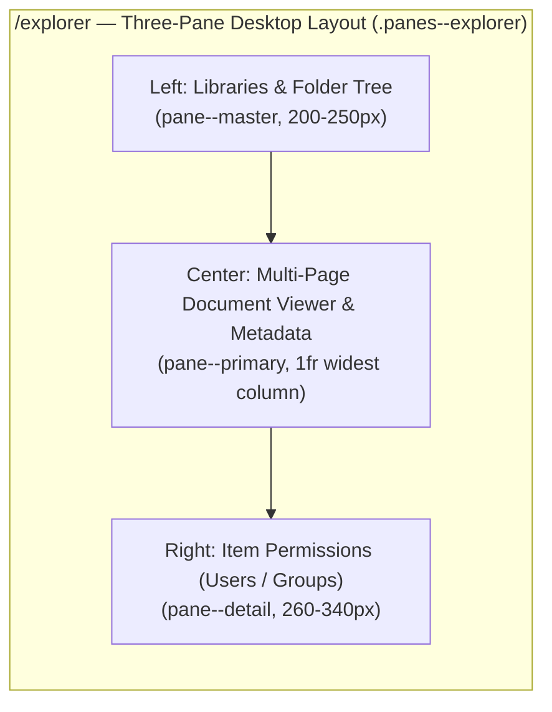

# SharePoint Knowledge Governance UI

Ionic and Angular web application for the SharePoint Knowledge Governance POC, providing an access and permission explorer, a document list filtered by knowledge category, hygiene cleanup, and Microsoft Foundry agent assistance.

## Local Development

### Prerequisites
- Node.js 22 LTS
- npm 10+

### Install Dependencies
```bash
npm install
```

### Development Server
```bash
npm start
```
Starts Angular dev server at `http://localhost:4200/`.

### Local Static Server
To serve the production build locally:
```bash
node server/static-server.mjs
```
Listens on port 8080 by default (`server/static-server.json`). The port can be overridden using the `PORT` environment variable (e.g., `PORT=4173 node server/static-server.mjs`).

## Testing

### Unit Tests (Karma + Jasmine)
Runs component and service unit tests in headless Chrome:
```bash
npx ng test --watch=false --browsers=ChromeHeadless
```
Covers:
- `ConfigService`: JSON contract acceptance and strict validation failure on invalid schema
- `ApiError`: Classification of unreachable, unauthorized, forbidden, notFound, and server errors
- `MicrosoftLogoComponent`: Microsoft logo mark and wordmark rendering
- `AgentFabComponent`: Foundry agent floating action button visibility and navigation
- `DocumentViewerComponent`: Multi-page in-page rendering and pagination (`All`, `Prev`, `1..N`, `Next`) for multi-page `.docx`, `.pptx`, `.xlsx`, and `.pdf` documents of varying length (with tables and embedded diagrams), plus `.mp4` video and `.vtt`/`.txt` transcripts
- `parseMarkdown` / `MarkdownComponent`: Safe Markdown rendering of agent answers (headings, tables, lists, bold, links, citation chips) with no `innerHTML`. The agent page also shows an animated thinking bubble with staged progress text while a reply is pending
- `groupByIssue`: Issue grouping and first-appearance ordering for prompts
- `CursorList`: Failed requests expose an error without throwing from data signals, and retry can recover

## Explorer & Side-by-Side Viewer Layout



### End-to-End Tests (Playwright Device Matrix)
Runs the responsive device matrix across web, desktop, tablet, and mobile profiles:
```bash
npx playwright test
```
If Chromium is missing:
```bash
npx playwright install chromium
```
To view HTML test reports:
```bash
npx playwright show-report
```
Screenshots for each tested device profile are saved to `test-results/screenshots/`.

The suite also exercises all eight page routes (including document detail),
signed-out gates, signed-in API failures, retry and timeout recovery, dashboard
findings, document refresh/category filtering, Explorer permissions, user access
and CSV export, cleanup segments, notification drafting/approval, and agent
citations. Synthetic MSAL accounts are installed through its public cache API;
test API responses are intercepted and no real sign-in or mail delivery occurs.
These browser tests validate the UI contract, not live SharePoint connectivity.

The static host reads the document route from `pages.json` so composite item
identifiers containing dots work on direct navigation and refresh. Missing
JavaScript and other assets still return 404 rather than the SPA shell.

## Production Build

```bash
npm run build
```
Generates optimized production assets in `www/`.

## Deployment

Deployment is documented in `deploy\README.md`.

## Configuration Files

All runtime behavior, visual themes, endpoints, and strings are controlled through configuration files:

### Application Runtime Configuration (`src/assets/config/`)
- `app.config.json`: API base URL, request timeout, page size, REST endpoints, Microsoft Entra authentication settings, and CSV export parameters.
- `layout.json`: Responsive layout breakpoints (mobile, tablet, desktop), pane sizing, sidebar width, tab bar height, spacing tokens, and icon mappings.
- `navigation.json`: Navigation items, routes, labels, icons, and menu groupings.
- `agent.json`: Foundry agent FAB configuration, message input limits, prompt paths, and placeholder extraction patterns.
- `strings.json`: Localized UI strings, accessibility labels, headers, and system status messages.
- `theme.json`: Microsoft brand colors, surface tokens, status indicators, and SVG logo asset paths. Surface tokens become `--surface-*` CSS variables, so stylesheets never hardcode colors.
- `pages.json`: Core route paths including home route and document detail route.

Every icon named in `layout.json`, `navigation.json`, or `agent.json` must be registered in `src/app/core/icons/icon-registry.ts`. The icon registry spec fails when one is missing, and an unregistered icon renders empty.

### Testing and Server Configuration
- `e2e/config/devices.json`: Playwright device profiles, viewports, touch support, and layout classifications.
- `e2e/config/e2e-server.json`: Playwright local server port, build and server commands, and screenshot output locations.
- `e2e/config/test-auth.json`: Synthetic authentication settings for Playwright route interception.
- `server/static-server.json`: Production static server root, SPA fallback, default port (8080), headers, MIME types, and caching rules.
