# Customer setup guide: SharePoint governance website and APIs

This guide takes a new customer from a checkout to a signed-in governance
website, live SharePoint APIs, and an optional Microsoft Foundry agent.
Commands use **PowerShell 7** and run from the repository root unless stated
otherwise. Replace every `<...>` value before running a command.

> **Scope and safety:** Use a non-production site first. The governance API
> reads SharePoint; it is not a permissions-remediation or document-deletion
> service. Permission auditing requires an elevated, site-scoped grant that
> also permits writes, even though the API does not use that capability.
> Notification delivery is disabled by default. Do not copy the demo tenant,
> application IDs, resource names, or GitHub federation subject into your setup.

## Contents

1. [Choose the deployment path](#1-choose-the-deployment-path)
2. [Prerequisites and identifiers](#2-prerequisites-and-identifiers)
3. [Roles and permissions reference](#3-roles-and-permissions-reference)
4. [Prepare configuration and Azure resources](#4-prepare-configuration-and-azure-resources)
5. [Register API and website authentication](#5-register-api-and-website-authentication)
6. [Prepare the SharePoint site and libraries](#6-prepare-the-sharepoint-site-and-libraries)
7. [Build and test locally](#7-build-and-test-locally)
8. [Deploy the API and website](#8-deploy-the-api-and-website)
9. [Authorize the API managed identity](#9-authorize-the-api-managed-identity)
10. [Enable the Foundry governance agent](#10-enable-the-foundry-governance-agent)
11. [Configure GitHub Actions](#11-configure-github-actions)
12. [Validate every customer journey](#12-validate-every-customer-journey)
13. [Optional Search and Foundry IQ pipeline](#13-optional-search-and-foundry-iq-pipeline)
14. [Operations, troubleshooting, and handover](#14-operations-troubleshooting-and-handover)
15. [Reference documentation](#15-reference-documentation)

## 1. Choose the deployment path

| Path | What you get | Follow |
| --- | --- | --- |
| Core website/API | Dashboard, Documents, Explorer permissions, user access, cleanup analytics, notification drafts | Sections 2-9, then 12 and 14 |
| Core + Foundry | The above plus model-generated answers grounded in live governance evidence | Also section 10 |
| Repeatable CI/CD | GitHub OpenID Connect deployment without stored Azure credentials | Also section 11 |
| Document search/Foundry IQ | Direct SharePoint indexing, embeddings, knowledge bases, and a separate retrieval agent | Also section 13; not required for the core website |

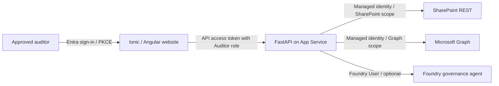

The website's **Total indexed documents** label refers to the live governance
scan; it is not proof that the separate Azure AI Search indexer has run.

### Screenshot conventions

The screenshots below are real captures of the demo deployment on
**2026-10-28**, not Azure portal mockups. They illustrate the screens to expect,
not customer-specific counts or proof that every permission is configured.
The agent input uses the illustrative address `auditor@contoso.com`.
Portal setup is described with explicit menu paths; portal labels can change.

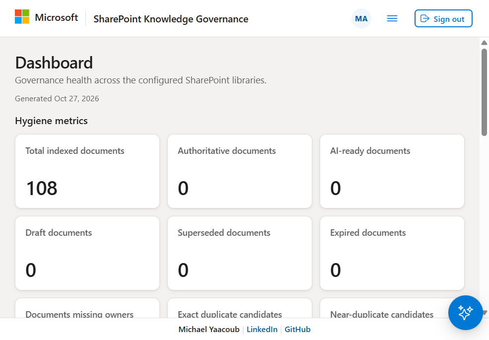

*Expected result: a populated Dashboard rather than an indefinite loading state.
Missing metadata is a data-quality issue, not evidence that setup is complete.*

## 2. Prerequisites and identifiers

### People and tools

- An Azure subscription and a Microsoft 365 tenant with SharePoint Online.
  Keep the website, API registration, managed identity, and SharePoint tenant
  aligned; this guide assumes a single tenant.
- A GitHub repository administrator if using Actions.
- An Azure resource administrator, an Entra consent administrator, and a
  SharePoint administrator/site owner. These can be different people.
- Git, Azure CLI with Bicep, PowerShell 7, Python **3.12 for the API**, and
  Node.js **22 LTS (22.12 or newer)** with npm. Root corpus/Trusted Knowledge
  automation is a separate Python environment; its CI uses Python 3.13.
- Chrome/Chromium for UI tests.
- For the authorization steps: `Microsoft.Graph.Authentication` PowerShell
  module. For optional corpus provisioning: `Az.Accounts`. For publishing the
  library template: SharePoint Online Management Shell.

Check installed tools:

```powershell
git --version
az version
az bicep version
pwsh --version
py -3.12 --version
node --version
npm --version
Get-Module -ListAvailable Microsoft.Graph.Authentication, Az.Accounts
```

Install missing prerequisites using your organization's approved distribution
method. A typical per-user Graph module installation is
`Install-Module Microsoft.Graph.Authentication -Scope CurrentUser`.
Do not install the whole Graph SDK merely to run the REST examples below.

### Record these values

| Value | Where to obtain it | Do not confuse it with |
| --- | --- | --- |
| Tenant ID | Entra ID > Overview | Subscription ID |
| Subscription ID and resource group | Azure portal > Subscriptions/resource groups | Microsoft 365 site |
| SharePoint host and site path | For example `contoso.sharepoint.com` and `/sites/knowledge` | The `-admin.sharepoint.com` management host |
| API application/client ID | Entra > App registrations > API > Overview | API managed identity client ID |
| SPA application/client ID | Entra > App registrations > website > Overview | API application ID |
| API enterprise application object ID | Entra > Enterprise applications > API | API registration's object ID |
| API managed identity principal/object ID | API App Service > Identity | Managed identity client/application ID |
| API managed identity client/application ID | Enterprise application for that identity | Principal/object ID |
| Website/API hostnames | App Service > Overview | OAuth resource/audience URI |
| Foundry account, project, model deployment | Foundry project and model deployment views | Model catalog name alone |
| GitHub OIDC subject | Actual subject emitted by your repository/environment | A copied demo subject |

The API registration secures **incoming auditor requests**. The App Service
managed identity authorizes **outgoing SharePoint/Graph requests**. Creating
one does not configure the other.

## 3. Roles and permissions reference

### 3.1 Azure resource roles (Azure IAM)

| Principal | Role | Scope | Purpose / created by |
| --- | --- | --- | --- |
| Bootstrap administrator | Contributor plus Role Based Access Control Administrator, or Owner | Target resource group; subscription if creating that group | Create resources and role assignments; temporary setup access |
| GitHub deployment managed identity | Contributor | Target resource group | Deploy App Services and Foundry project; bootstrap template |
| GitHub deployment managed identity | User Access Administrator | Existing Foundry account only | Create project role grants; bootstrap template |
| GitHub deployment managed identity | Storage Blob Data Contributor | Bootstrap state storage account | Only when `terraformState.create` is true; bootstrap template |
| API system-assigned identity | Foundry User (`53ca6127-db72-4b80-b1b0-d745d6d5456d`) | Governance Foundry project | Invoke the agent; Foundry component template |
| GitHub deployment managed identity | Foundry User | Governance Foundry project | Create/version the agent; Foundry component template |
| Operator running manual agent upsert | Foundry User | Governance Foundry project | Data-plane agent calls; assign separately for manual deployment |
| Optional Search identity | Cognitive Services OpenAI User | Embedding account | Generate embeddings; Search provisioning script |
| Optional Foundry IQ project identity | Search Index Data Reader | Search service | Read indexed documents; Foundry IQ provisioning script |
| Optional Search identity | Cognitive Services User | Foundry IQ account | Knowledge-base model access; Foundry IQ provisioning script |

Contributor does **not** grant Microsoft Graph/SharePoint data access and does
not generally permit Azure role assignment creation. Ordinary website users
need no subscription role.

In Azure portal, inspect these under **resource > Access control (IAM) > Role
assignments**. Inspect the API identity under **App Service > Identity >
System assigned**. Inspect the deployment identity under **Managed Identities**.

### 3.2 Entra, SharePoint, and application roles

| Principal | Permission / role | Scope and consent |
| --- | --- | --- |
| Human consent administrator | Privileged Role Administrator or Global Administrator, as required by tenant policy | Time-bound elevation to approve Microsoft Graph application permissions; not a runtime role |
| SharePoint setup administrator | SharePoint Administrator, with the necessary target-site administration rights | Site/library/template setup and approval of site access |
| Website SPA | Delegated API permission `api://<API_CLIENT_ID>/access_as_user` | Your API registration; authorize/consent this client |
| Approved auditor user/group | `Auditor` application role | **API enterprise application**, not the website or Azure subscription |
| API managed identity | Microsoft Graph **application** `Sites.Selected` | Tenant admin consent; requires a separate target-site grant |
| API managed identity | SharePoint Online **application** `Sites.Selected` | Separate resource from Microsoft Graph; requires a separate app-role assignment |
| API managed identity | `fullcontrol` site grant | Only the explicitly approved target site; needed for SharePoint REST permission enumeration |
| API managed identity | Microsoft Graph application `GroupMember.Read.All` | Expand Entra groups for access analysis |
| API managed identity | Microsoft Graph application `User.Read.All` | Resolve users/account status for access/exposure |
| Optional mail delivery identity | Graph application `Mail.Send`, or an approved Exchange application-RBAC design | Only for a separately approved live-mail rollout; not needed in dry run |

**Important authorization boundary:** `Sites.Selected` alone gives no site
access. A `read` grant can read documents but is insufficient for the
SharePoint REST role-assignment operations used by this application.
`fullcontrol` on a selected site is powerful: it can modify that site's content
and permissions. Obtain explicit customer approval, protect the API identity,
and do not substitute tenant-wide `Sites.FullControl.All`.

The existing demo was initially configured with Graph `Sites.Read.All`,
`Files.Read.All`, `GroupMember.Read.All`, `User.Read.All`, and SharePoint
`Sites.Read.All`. Those broad read permissions did **not** make role-assignment
auditing work. For a new customer, use the selected-site design above and test
all journeys. Existing broad grants remain broad until explicitly removed;
adding `Sites.Selected` does not narrow them.

## 4. Prepare configuration and Azure resources

### 4.1 Clone and select the target subscription

Fork this repository into your organization's GitHub account first, or use
your organization's approved copy. Clone that repository below.

```powershell
git clone https://github.com/<YOUR_ORG>/SharePoint-AISearch-POC.git
Set-Location .\SharePoint-AISearch-POC

$tenantId = '<TENANT_ID>'
$subscriptionId = '<SUBSCRIPTION_ID>'
$rg = '<RESOURCE_GROUP>'
$location = '<AZURE_REGION>'
$plan = '<LINUX_APP_SERVICE_PLAN>'
$apiName = '<GLOBALLY_UNIQUE_API_APP_NAME>'
$uiName = '<GLOBALLY_UNIQUE_UI_APP_NAME>'

az login --tenant $tenantId
az account set --subscription $subscriptionId
az account show --query '{tenant:tenantId,subscription:id}' -o json
az group create --name $rg --location $location
az appservice plan create --name $plan --resource-group $rg `
    --location $location --is-linux --sku B2
```

This creates chargeable resources. **B2 is a starting point for this POC, not
a production sizing guarantee.** The demo's shared B1 plan hosted five apps
and sustained 99-100% CPU during deployment, preventing both API and website
startup. The approved B2 scale-up restored service. Prefer a dedicated plan,
monitor CPU/memory, and size for corpus volume and concurrent scans.
The component Bicep template references an **existing plan**; it does not
create or resize it.

### 4.2 Edit the checked-in deployment contract

| File | Customer-specific changes |
| --- | --- |
| [deploy/settings.json](../deploy/settings.json) | Tenant/subscription/group, region, existing plan, GitHub owner/repository/environment, identity names, unique state storage name, exact OIDC subject |
| [API descriptor](../deploy/components/api.json) | API app name, tenant, API registration IDs, allowed website origin, optional Foundry target |
| [UI descriptor](../deploy/components/ui.json) | Website app name; packaged API URL, SPA client ID, tenant authority, redirect/logout URLs and API scope under `package.patchJson` |
| [Foundry descriptor](../deploy/components/foundry-agent.json) | Existing account, correct account region, new project/agent names, available model deployment, API app name, new role-assignment GUID |
| [Shared site configuration](../config/trusted-knowledge.json) | Tenant/subscription and `sharePoint.siteUrl`; review vocabulary/owner placeholders before provisioning |
| [API configuration](../app/api/config/api.config.json) | Optional `sharePoint.libraryDisplayNames` allowlist, limits, cache, timeouts |
| [Local UI configuration](../app/ui/src/assets/config/app.config.json) | Local API URL and local SPA sign-in settings; production packaging patches a separate built copy |

If `sharePoint.libraryDisplayNames` is empty, the service discovers document
libraries on the configured site. Set an explicit allowlist to keep the crawl
bounded. The configured `productionLibraryName` alone is not that allowlist.
The core API uses the site in `config/trusted-knowledge.json`, whereas the
optional original corpus/Search pipeline defaults to `config/deployment.json`.
Keep those files aligned with the pipeline you actually run.

Every App Service deployment **replaces the full app-settings collection**
from its descriptor. Portal-only edits will be lost on the next deployment.
Store approved persistent changes in the descriptor. Keep tokens, secrets,
Search keys, and private certificates out of Git and screenshots.

## 5. Register API and website authentication

Use [Microsoft Entra admin center](https://entra.microsoft.com/), in the customer
tenant. These are two app registrations, in addition to the API's later managed
identity.

### 5.1 API registration

1. **Identity > Applications > App registrations > New registration**.
   Name it, for example, `Knowledge Governance API`; select **Accounts in this
   organizational directory only**. No redirect URI is needed for this API.
2. Record the **Application (client) ID** as `$apiClientId`.
3. **Expose an API > Application ID URI**: set `api://<API_CLIENT_ID>`.
4. **Add a scope** named `access_as_user`; choose admin consent according to
   policy, enter consent descriptions, and enable the scope.
5. **App roles > Create app role**:
   - Display name/value: `Auditor`.
   - Allowed member types: **Users/Groups**.
   - Description: permission to review site-wide governance and access data.
   - Enable the role.
6. Ensure the registration requests **v2 access tokens**. In the application
   manifest's API settings, `api.requestedAccessTokenVersion` must be `2`.
7. In **Enterprise applications > this API > Properties**, consider
   **Assignment required? Yes**, then **Users and groups > Add user/group**.
   Assign only approved auditors to **Auditor**. Group assignment depends on
   your Entra licensing; individual users can be assigned instead.

Do not assign every employee as Auditor. Requests are executed with the API's
application identity, **not on behalf of the signed-in user's SharePoint
permissions**. An auditor can receive site-wide content and permission facts
within the identity's authorized scope.

### 5.2 Website SPA registration

1. Create a second, single-tenant registration, e.g. `Knowledge Governance Web`.
2. **Authentication > Add a platform > Single-page application**:
   - Production redirect URI: `https://<UI_APP_NAME>.azurewebsites.net`.
   - Local redirect URI: `http://127.0.0.1:4200`.
   - If you use `http://localhost:4200`, register it separately and configure
     that exact origin everywhere. Do not mix the two local hostnames.
3. Keep authorization-code flow with PKCE; do not enable implicit flow or
   create a SPA client secret.
4. **API permissions > Add a permission > My APIs > your API >
   Delegated permissions**: select `access_as_user`. Grant admin consent if
   required by the tenant.
5. In the **API registration > Expose an API > Authorized client applications**,
   add the SPA client ID and select the `access_as_user` scope. This
   pre-authorizes the SPA; it does not assign the user's Auditor role.
6. Record `$spaClientId`. Set the UI authority to
   `https://login.microsoftonline.com/<TENANT_ID>` and scopes to
   `["api://<API_CLIENT_ID>/access_as_user"]`.
7. Put the API client ID into the API descriptor's
   `API_CONFIG__auth__clientId` and `API_CONFIG__auth__audience`
   (`api://<API_CLIENT_ID>` for the latter).

**Checkpoint:** A fresh sign-in must produce an API token for your API with
the `Auditor` role. A token for Microsoft Graph or Azure Resource Manager is
not an API token. Never print bearer tokens in CI or copy them into this guide.
Sign out/in after changing role assignment or consent.

## 6. Prepare the SharePoint site and libraries

1. Create or choose a private test site in the customer tenant. Record its
   ordinary site URL, e.g. `https://contoso.sharepoint.com/sites/knowledge`.
2. Add the setup operator as a site owner/administrator as appropriate.
   Website Auditor assignment does not grant human SharePoint site access.
3. Create a document library, upload a small representative corpus, and retain
   normal document/folder permissions. Do not break inheritance merely to test
   that the application can list items.
4. For governance metadata, publish and use the repository's **Governed
   Knowledge** library template. The complete procedure and 27 internal
   column names are in [the library-template guide](knowledge-library-template.md).

   From a SharePoint-administrator PowerShell session with the supported
   SharePoint Online module installed:

   ```powershell
   .\scripts\Publish-KnowledgeLibraryTemplate.ps1 `
       -AdminUrl https://<TENANT>-admin.sharepoint.com -WhatIf
   $template = .\scripts\Publish-KnowledgeLibraryTemplate.ps1 `
       -AdminUrl https://<TENANT>-admin.sharepoint.com
   $template
   ```

5. On the site, **Site contents > New > Document library > From your
   organization > Governed Knowledge > Use template**. Choose a unique name.
   Open **Knowledge Documents** and **All Metadata** views.
6. Populate stable Artifact IDs, owners, categories, lifecycle, review dates,
   and other approved metadata. The template creates schema; it does not run
   a governance workflow or calculate trust scores.
7. Update `sharePoint.siteUrl` and the API's library allowlist.

Existing libraries without governance columns can still be browsed with base
metadata. Expect **Not available** fields and a coverage warning; do not treat
zero authoritative/AI-ready documents as a completed governance rollout.
The demo's **Trusted Knowledge** library is not automatically provisioned by
deploying this website or by the validation-only Trusted Knowledge workflow.

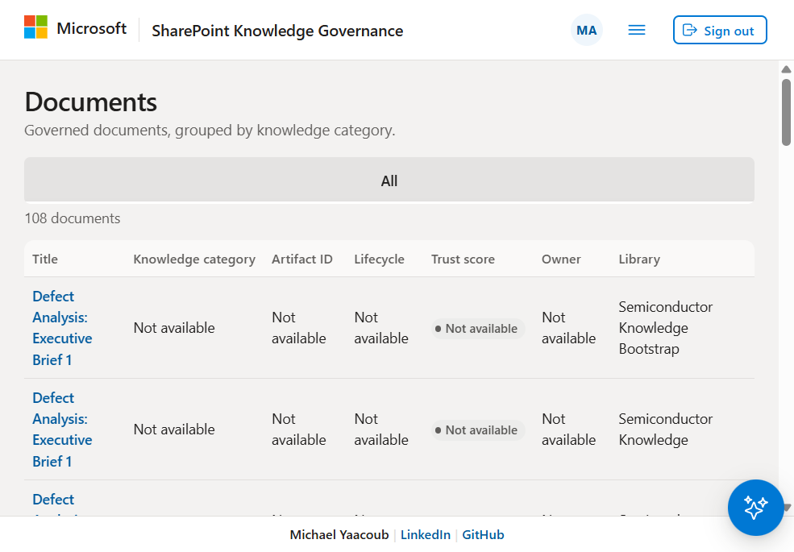

*Checkpoint: titles and library names should load. Your document count and
metadata will differ from the demo.*

## 7. Build and test locally

### 7.1 API (terminal A)

```powershell
py -3.12 -m venv app\api\.venv
& .\app\api\.venv\Scripts\python.exe -m pip install `
    -r app\api\requirements.txt -r app\api\requirements-dev.txt
& .\app\api\.venv\Scripts\python.exe -m pytest -q

Set-Location .\app\api
$env:API_CONFIG__auth__audience = 'api://<API_CLIENT_ID>'
$env:API_CONFIG__auth__clientId = '<API_CLIENT_ID>'
$env:API_CONFIG__cors__allowedOrigins = 'http://127.0.0.1:4200'
& .\.venv\Scripts\python.exe -m uvicorn app.asgi:app `
    --host 127.0.0.1 --port 8000
```

Open `http://127.0.0.1:8000/health` and `/docs`.
Use Uvicorn on Windows; Gunicorn is the Linux App Service startup server.
The first pytest command runs from the **repository root**, including
repository-level tests.

Outside App Service, the API uses `DefaultAzureCredential`; inside App Service
it uses managed identity. Local health/tests do not prove live SharePoint
authorization. A developer credential must separately be authorized for both
Graph and the SharePoint resource; `az login` alone may not supply the needed
consented scopes. Never borrow the browser's API token as a backend Graph
credential. Use the deployed managed-identity API for the live acceptance
tests if local developer authorization has not been approved.

### 7.2 Website (terminal B)

Edit [the local UI configuration](../app/ui/src/assets/config/app.config.json):

```json
{
  "apiBaseUrl": "http://127.0.0.1:8000/api/v1",
  "auth": {
    "clientId": "<SPA_CLIENT_ID>",
    "authority": "https://login.microsoftonline.com/<TENANT_ID>",
    "redirectUri": "http://127.0.0.1:4200",
    "postLogoutRedirectUri": "http://127.0.0.1:4200",
    "cacheLocation": "localStorage",
    "apiScopes": ["api://<API_CLIENT_ID>/access_as_user"]
  }
}
```

This is a **partial example**: retain the existing endpoints, export settings,
page size, and timeout in that file.

```powershell
Set-Location .\app\ui
npm ci
npm test -- --browsers=ChromeHeadless
npm run lint
npm run build -- --configuration production
npx playwright install chromium
npm run e2e
npm start -- --host 127.0.0.1
```

Open `http://127.0.0.1:4200` and sign in as an assigned auditor.
Tests install synthetic MSAL/API fixtures only in the browser test harness;
there is no production authentication bypass. The responsive matrix currently
uses Chromium, including fallback profiles named for other browsers. Do not
claim native Safari/Firefox certification from those runs.

## 8. Deploy the API and website

Choose **manual first deployment** here, then configure CI in section 11.
The deployment helper uses only the Python standard library. Run from the
repository root, using a Python interpreter available as `python`.

### 8.1 Deploy App Service infrastructure

```powershell
python scripts\deploy\deploy_tool.py validate-iac
foreach ($component in @('api', 'ui')) {
    $out = ".state\customer-deploy\$component"
    python scripts\deploy\deploy_tool.py render --component $component --out $out
    az deployment group create --resource-group $rg `
        --name "customer-$component" `
        --template-file infra\bicep\components\app-service\main.bicep `
        --parameters "@$out\bicep-params.json"
    if ($LASTEXITCODE -ne 0) { throw "Infrastructure deployment failed: $component" }
}
```

The template enables HTTPS, TLS 1.2+, Always On and system-assigned identity,
and sets the runtime, startup command and health path.

### 8.2 Build packages

Build the website first with section 7.2. Then:

```powershell
python scripts\deploy\deploy_tool.py package --component api `
    --out .state\customer-deploy\api
python scripts\deploy\deploy_tool.py package --component ui `
    --out .state\customer-deploy\ui
```

API packaging downloads the configured **Linux/Python 3.12 wheels** into
`.python_packages/lib/site-packages`. Do not zip a Windows virtual environment
or deploy only the API source without its dependencies.

### 8.3 Upload, wait for startup, then check health

```powershell
az webapp deploy --resource-group $rg --name $apiName `
    --src-path .state\customer-deploy\api\api.zip `
    --type zip --clean true --restart true --async false --timeout 1200000
if ($LASTEXITCODE -ne 0) { throw 'API deployment/startup failed; inspect logs.' }
az webapp deploy --resource-group $rg --name $uiName `
    --src-path .state\customer-deploy\ui\ui.zip `
    --type zip --clean true --restart true --async false --timeout 1200000
if ($LASTEXITCODE -ne 0) { throw 'Website deployment/startup failed; inspect logs.' }
python scripts\deploy\deploy_tool.py health --component api
python scripts\deploy\deploy_tool.py health --component ui
```

Do not restart an app while Kudu is still unpacking the package. A Kudu
deployment with status `4` proves package deployment, **not application
startup or data access**. The current Actions workflow uses asynchronous ZIP
deployment with startup tracking, Kudu completion polling, restart and health
checking; it can still fail if the worker never starts.

| Component | Runtime / startup | Essential app settings |
| --- | --- | --- |
| Website | `NODE\|22-lts`; `node server/static-server.mjs` | `SCM_DO_BUILD_DURING_DEPLOYMENT=false`, `WEBSITES_PORT=8080` |
| API | `PYTHON\|3.12`; `python -m gunicorn -k uvicorn.workers.UvicornWorker app.asgi:app --bind 0.0.0.0:8000 --timeout 180` | `SCM_DO_BUILD_DURING_DEPLOYMENT=false`, `PYTHONPATH=/home/site/wwwroot/.python_packages/lib/site-packages:/home/site/wwwroot`, port `8000`, startup limit `600` |

The API descriptor also supplies incoming auth IDs, trusted CORS origin,
shared-config paths, and optional Foundry settings. API CORS must match the
website's exact **origin**, without a path. Avoid configuring an additional
App Service CORS policy that conflicts with the application's policy.

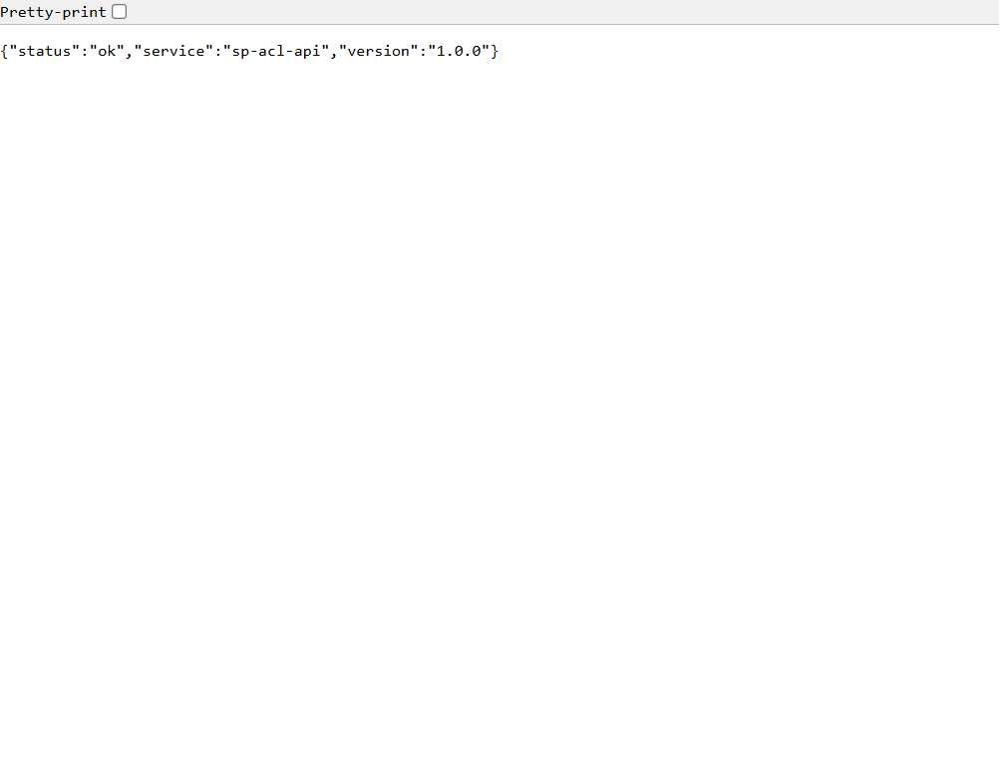

*Checkpoint: `/health` is public and returns `status: ok`. This says nothing
about the managed identity's SharePoint permissions.*

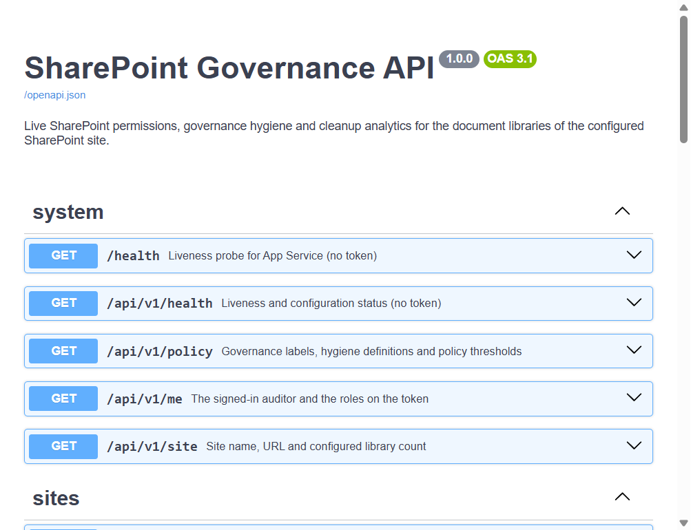

*Open `/docs` for the contract and `/openapi.json` for clients. Protected
endpoints still require an API bearer token with the Auditor role; Swagger
does not automatically sign you into the website.*

## 9. Authorize the API managed identity

This is a **separate, administrator-approved operation**. Azure Contributor
does not configure it. Run the following in a customer-controlled PowerShell
terminal after section 8 creates the API's system-assigned identity.

### 9.1 Sign in to Graph as the consent/site administrator

```powershell
Import-Module Microsoft.Graph.Authentication
Connect-MgGraph -TenantId $tenantId `
    -Scopes 'Application.Read.All','AppRoleAssignment.ReadWrite.All','Sites.FullControl.All' `
    -ContextScope Process -NoWelcome
```

Review the consent dialog. These are **delegated administrative-session
permissions**, not the API identity's application permissions.
`Sites.FullControl.All` in this administrator session is used to create the
one-site grant; do not assign that tenant-wide application role to the API.
Tenant policy and administrator roles still apply.
The delegated user creating the site grant must be a SharePoint Administrator
or higher **and a member of the target site**. Entra consent rights alone do
not satisfy those SharePoint requirements.

If Windows WAM reports **A window handle must be configured**, use a standalone
PowerShell terminal or device sign-in:

```powershell
Connect-MgGraph -TenantId $tenantId `
    -Scopes 'Application.Read.All','AppRoleAssignment.ReadWrite.All','Sites.FullControl.All' `
    -ContextScope Process -UseDeviceAuthentication -NoWelcome
```

Complete the current device code promptly. Expired codes and a failed
interactive sign-in make **no grant**. Never share passwords or tokens.

### 9.2 Assign selected-site and directory-read application roles

Continue in the **same authenticated terminal**:

```powershell
$ErrorActionPreference = 'Stop'
$Graph = 'https://graph.microsoft.com/v1.0'
$miId = az webapp identity show --resource-group $rg --name $apiName `
    --query principalId -o tsv
if ($LASTEXITCODE -ne 0 -or -not $miId) { throw 'API managed identity not found.' }
$mi = Invoke-MgGraphRequest -Method GET -Uri "$Graph/servicePrincipals/$miId"

$resources = @(
    @{ AppId = '00000003-0000-0000-c000-000000000000'
       Roles = @('Sites.Selected', 'GroupMember.Read.All', 'User.Read.All') },
    @{ AppId = '00000003-0000-0ff1-ce00-000000000000'
       Roles = @('Sites.Selected') }
)
foreach ($resource in $resources) {
    $filter = [Uri]::EscapeDataString("appId eq '$($resource.AppId)'")
    $matches = Invoke-MgGraphRequest -Method GET `
        -Uri "$Graph/servicePrincipals?`$filter=$filter"
    if (@($matches.value).Count -ne 1) { throw 'Resource service principal not found uniquely.' }
    $sp = $matches.value[0]
    foreach ($roleName in $resource.Roles) {
        $roles = @($sp.appRoles | Where-Object {
            $_.value -eq $roleName -and $_.allowedMemberTypes -contains 'Application'
        })
        if ($roles.Count -ne 1) { throw "Application role not found uniquely: $roleName" }
        $assigned = Invoke-MgGraphRequest -Method GET `
            -Uri "$Graph/servicePrincipals/$miId/appRoleAssignments"
        $existing = @($assigned.value | Where-Object {
            $_.resourceId -eq $sp.id -and $_.appRoleId -eq $roles[0].id
        })
        if (-not $existing.Count) {
            $body = @{
                principalId = $miId
                resourceId = $sp.id
                appRoleId = $roles[0].id
            } | ConvertTo-Json
            Invoke-MgGraphRequest -Method POST `
                -Uri "$Graph/servicePrincipals/$miId/appRoleAssignments" `
                -Body $body -ContentType 'application/json' | Out-Null
        }
    }
}
```

This does not create secrets, grant tenant-wide site access, or modify any
human user's SharePoint permissions. Directory-read permissions remain
tenant-wide; review them with the customer.

### 9.3 Grant Full Control only on the approved site

```powershell
$siteHost = '<TENANT>.sharepoint.com'
$sitePath = '/sites/<APPROVED_SITE>'
$expectedSiteUrl = "https://$siteHost$sitePath"
$site = Invoke-MgGraphRequest -Method GET -Uri "$Graph/sites/${siteHost}:$sitePath"
if ($site.webUrl.TrimEnd('/') -ne $expectedSiteUrl.TrimEnd('/')) {
    throw 'Resolved site differs from the approved site.'
}
$siteId = $site.id
$permissions = Invoke-MgGraphRequest -Method GET -Uri "$Graph/sites/$siteId/permissions"
$existing = @($permissions.value | Where-Object {
    @($_.grantedToIdentitiesV2.application.id) +
    @($_.grantedToIdentities.application.id) -contains $mi.appId
})
if ($existing.Count -gt 1) { throw 'Multiple grants found; review before changing.' }
if ($existing.Count -eq 1) {
    $grantId = $existing[0].id
    Invoke-MgGraphRequest -Method PATCH `
        -Uri "$Graph/sites/$siteId/permissions/$grantId" `
        -Body '{"roles":["fullcontrol"]}' -ContentType 'application/json' | Out-Null
} else {
    $body = @{
        roles = @('fullcontrol')
        grantedToIdentities = @(@{
            application = @{ id = $mi.appId; displayName = $apiName }
        })
    } | ConvertTo-Json -Depth 6
    $grant = Invoke-MgGraphRequest -Method POST -Uri "$Graph/sites/$siteId/permissions" `
        -Body $body -ContentType 'application/json'
    $grantId = $grant.id
}
$verified = Invoke-MgGraphRequest -Method GET `
    -Uri "$Graph/sites/$siteId/permissions/$grantId"
if ($verified.roles -notcontains 'fullcontrol') { throw 'Site grant did not verify.' }
[pscustomobject]@{
    Site = $site.webUrl
    IdentityClientId = $mi.appId
    PermissionId = $grantId
    Roles = $verified.roles
}
Disconnect-MgGraph
```

Retain the non-secret site ID, identity IDs and permission ID in the customer's
handover record. Allow permission propagation; refresh/restart the API after
the grant is complete to clear its in-process tokens/caches. Managed identity
token caching can delay new app-role claims beyond an app restart.
Retest **permissions, access records, anomalies and exposure**, not just files.

To revoke **this site grant**, reconnect as an approved administrator, verify
the recorded identifiers, then call:

```powershell
Invoke-MgGraphRequest -Method DELETE `
    -Uri "https://graph.microsoft.com/v1.0/sites/<SITE_ID>/permissions/<PERMISSION_ID>"
```

Recheck existing `Sites.Read.All`, `Files.Read.All` or other grants separately.
Revoking a selected-site grant does not remove independent broad permissions.

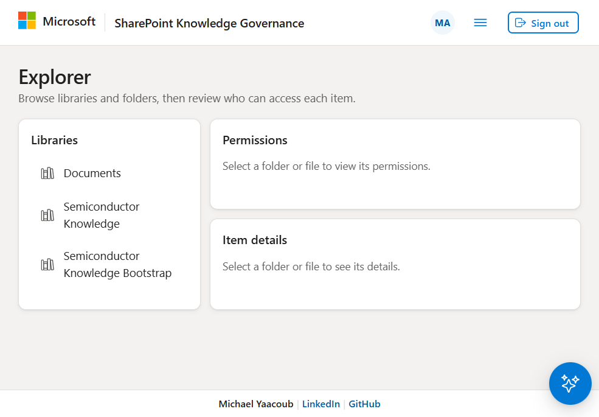

*Checkpoint: library browsing is only the first test. Selecting a file/folder
must also return its permission entries; a loaded library list alone is not
an authorization acceptance test.*

## 10. Enable the Foundry governance agent

The core governance agent uses **live API evidence**. It is different from the
optional Search/Foundry IQ agent in section 13.

1. In [Microsoft Foundry](https://ai.azure.com/), create/select a supported
   Foundry account in the customer's subscription/resource group.
   The repository's templates reference an **existing account**; they do not
   deploy the account or model.
2. Deploy a supported chat model with adequate quota. Record its **deployment
   name**. The demo descriptor uses `gpt-5.2`; availability is tenant/region
   dependent. Do not copy a catalog/model name without deploying it.
3. Set account/project/agent/model in the Foundry descriptor. Set the project
   location to the existing account's region, not blindly to the web region.
   Generate a new `foundry.apiIdentityRole.assignmentName` GUID for a new
   customer's role assignment.
4. Bootstrap the deployment identity first (section 11.1). Then render/deploy:

   ```powershell
   python scripts\deploy\deploy_tool.py render --component foundry-agent `
       --out .state\customer-deploy\foundry-agent
   az deployment group create --resource-group $rg --name customer-foundry `
       --template-file infra\bicep\components\foundry-agent\main.bicep `
       --parameters '@.state\customer-deploy\foundry-agent\bicep-params.json'
   ```

5. The template creates/adopts the project and assigns **Foundry User** to the
   API and deployment identities at that project. If you run upsert yourself,
   an administrator must grant **your operator identity** Foundry User there
   too; Contributor alone is not the data-plane permission.
6. Preview and upsert the agent:

   ```powershell
   python scripts\deploy\deploy_tool.py upsert-foundry --component foundry-agent --dry-run
   python scripts\deploy\deploy_tool.py upsert-foundry --component foundry-agent
   ```

7. Set `API_AGENT__foundry__accountName`, `projectName`, and `agentName` in the
   API descriptor and redeploy. The three names must match the deployed agent.
   To intentionally use evidence-only mode, leave all three unset/null in
   configuration and omit all three overrides; do not leave demo targets.

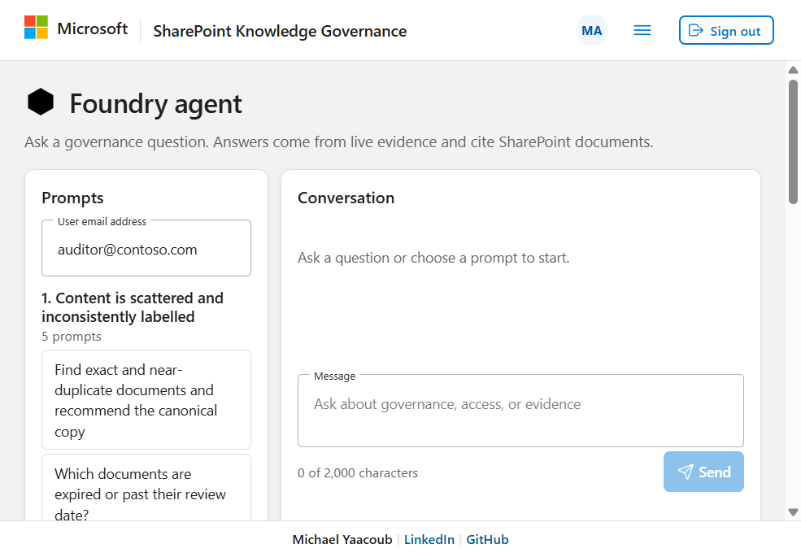

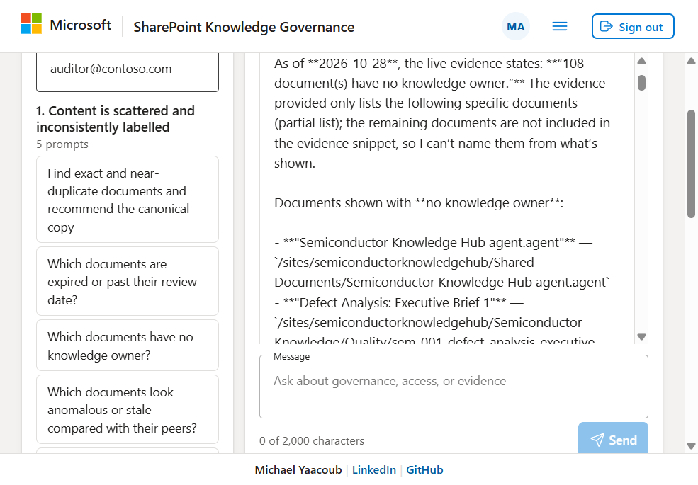

*Checkpoint: ask a read-only question such as "Which documents have no knowledge
owner?" Check the answer and SharePoint citations. Do not use a notification
drafting prompt as the initial connectivity test.*

## 11. Configure GitHub Actions

### 11.1 Bootstrap Azure federation once

First edit `deploy/settings.json`. The OIDC subject must match your repository
and production environment **exactly**. For standard GitHub subject format it
is `repo:<OWNER>/<REPO>:environment:production`; repositories with customized
or immutable-ID subject formats must use their actual emitted value.
The checked-in demo uses an ID-bearing subject: do not copy it.

With the existing Foundry account available, run as the Azure bootstrap admin:

```powershell
python scripts\deploy\deploy_tool.py render-bootstrap `
    --out .state\customer-deploy\bootstrap
az deployment group create --resource-group $rg --name customer-bootstrap `
    --template-file infra\bicep\bootstrap\main.bicep `
    --parameters '@.state\customer-deploy\bootstrap\bicep-params.json'
az deployment group show --resource-group $rg --name customer-bootstrap `
    --query properties.outputs -o json
```

Use output **clientId**, not principalId, for `AZURE_CLIENT_ID`. The bootstrap
creates the deployment managed identity/federation and the Azure roles in
section 3. It does **not** configure API app registrations, human Auditor
assignment, Graph consent, SharePoint site grants, or model deployments.
The optional state storage account does not stage SharePoint documents.

For a core-only deployment without Foundry, disable
`grantUserAccessAdministratorOnFoundryAccount`, omit the Foundry component,
and do not run the Foundry steps. Set `terraformState.create` false if that
unused state store is not wanted. Only Bicep is implemented despite the
descriptors also listing planned Terraform roots.

### 11.2 GitHub repository settings

1. **Settings > Environments > New environment > production**. Restrict
   deployment branches and configure reviewers according to customer policy.
2. **Settings > Secrets and variables > Actions > Variables**: create
   **repository variables** `AZURE_CLIENT_ID`, `AZURE_TENANT_ID`,
   `AZURE_SUBSCRIPTION_ID`. These identifiers are not secrets. The deployment
   gate reads the repository variable `AZURE_CLIENT_ID`.
3. Allow the workflows' `contents: read` and `id-token: write` permissions.
4. Merge reviewed customer configuration to the default `main` branch.
   A push matching component paths validates, then deploys. Pull requests
   validate only. The supplied workflows do not expose `workflow_dispatch`.
5. **Actions > API / UI / Foundry agent > latest run**: check validation,
   packaging smoke, infrastructure, upload/startup, and health steps.
   Re-run failed jobs only after the underlying problem is corrected.

Changing shared deployment settings, infrastructure, deployment helpers, or
workflows can redeploy all deployable components. Keep workflow literal path
filters aligned with descriptor `triggerPaths`. The supplied workflow branch
filters and conditions explicitly name `main`; changing only
`github.defaultBranch` in settings does not change those filters.

For step-level details, see [Deployment](../deploy/README.md).

## 12. Validate every customer journey

Sign in as an approved auditor. Use a small, known document with an owner and
a known group permission. Check browser Network status and API logs as well as
the visible result. **Health 200 and a green deployment do not certify these
flows.**

| Page / journey | Expected result | Setup dependency |
| --- | --- | --- |
| `/dashboard` | Metrics/findings load; opening a nonempty finding lists documents | SharePoint site/library reads; metadata for meaningful counts |
| `/explorer` | Libraries, folder expansion, file details, permission entries | Selected-site Full Control plus Graph link/directory access |
| `/documents` | Titles, pagination, sorting and populated category filters work | File reads and governance schema |
| `/documents/<library-guid>.<item-number>` | Open a real document link, then refresh; still renders detail | Static SPA deep-link fallback and an actual file ID, not a folder ID |
| `/access/by-user` | Search at least two characters, choose a user, load access records, export CSV | SharePoint permission enumeration, group membership and user reads |
| `/cleanup` | Check **Duplicates, Expiry, Anomalies and Exposure** individually | Content reads; anomalies/exposure also need permission analysis |
| `/notifications` | All status tabs load; draft/preview/approve only against test data | Writable outbox and dry-run mode |
| `/agent` | Prompts load; a read-only question returns evidence/citations | Same live data grants; optional Foundry project/model/role |
| Signed out / unauthorized | Data is gated; missing token gets 401, missing Auditor role gets 403 | Incoming API authentication and role assignment |
| Failed request / retry | Explicit error and retry, not endless Loading | Error-state handling; working CORS |

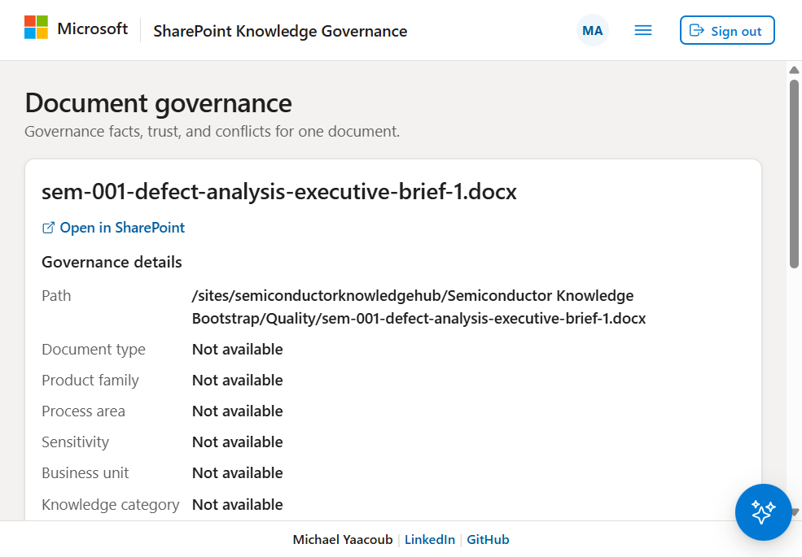

*Use a document link from the list. An identifier ending in `.1` can name a
folder and legitimately return "Not found" in the document-detail page.*

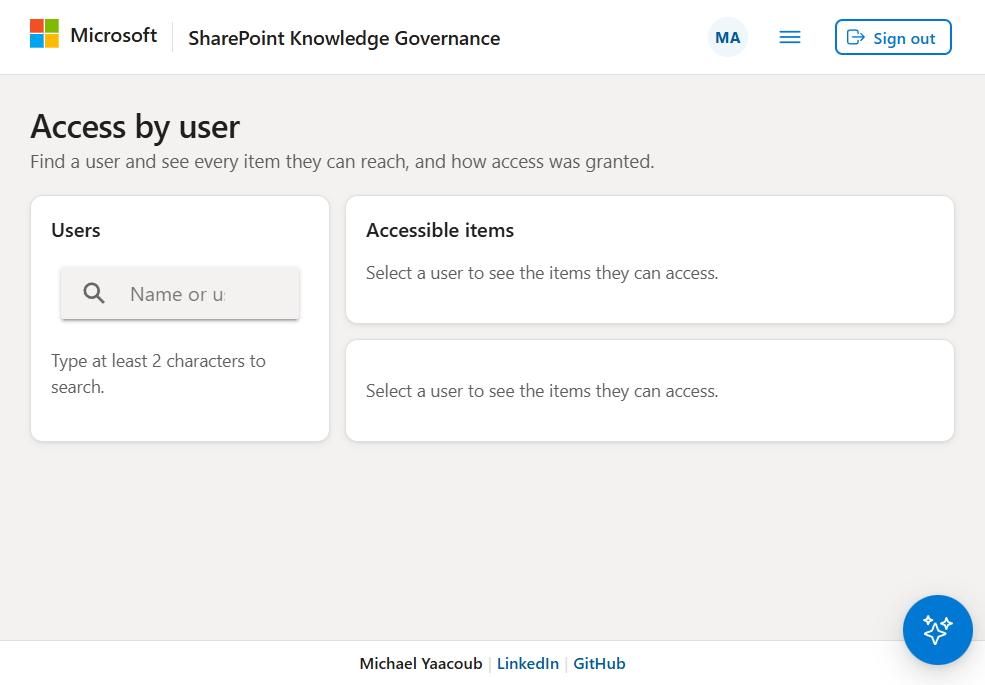

*Search success is not sufficient: selecting the user must populate Accessible
items before CSV export is considered verified.*

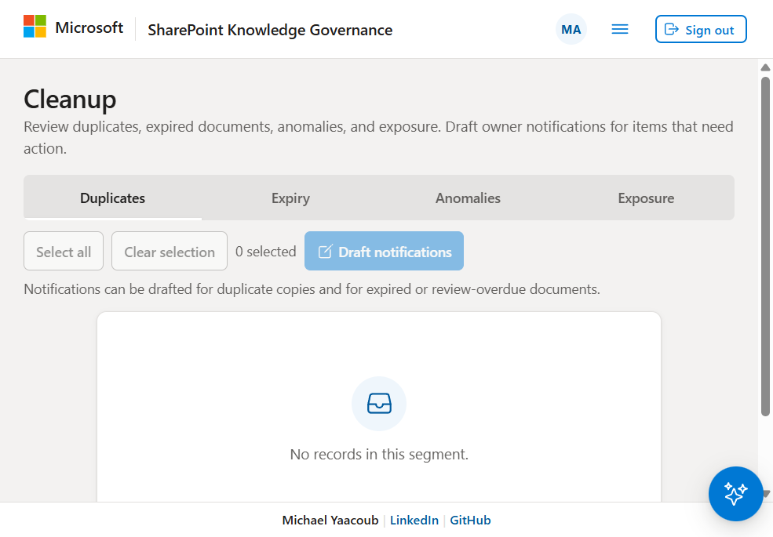

*An empty segment can be legitimate. Verify it against known test data; a
permission failure must never be treated as an empty successful scan.*

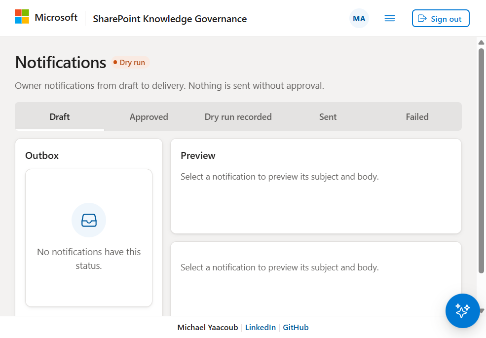

*A clean outbox is expected before creating test drafts. Do not enable live mail
just to make this page nonempty.*

### Acceptance evidence and current demo limitations

On 2026-10-28, after the approved B2 scale-up, live checks confirmed Dashboard,
108 documents, actual document detail/refresh, library browsing, user search,
Duplicates/Expiry segments, notification listing, and a read-only agent answer
with 25 citations. **Explorer permission entries, access records,
Anomalies and Exposure were blocked by SharePoint `upstream_forbidden`.**
The subsequent administrator sign-in attempts did not complete successfully;
the approved site-grant operation had not run at the time of this guide.
Those blocked features must be retested after section 9, not marked complete.

Local regression evidence from the preceding fix: 147 Python tests, 34 UI unit
tests and 49 browser tests passed. Browser tests use synthetic APIs/accounts;
they do not validate customer consent, live Microsoft 365 access or mail.
Live notification sending was not exercised.

## 13. Optional Search and Foundry IQ pipeline

Skip this section when deploying only the governance website/API.
There are **two distinct agents**: the website governance agent in section 10,
and the document retrieval/Foundry IQ agent configured by
`config/deployment.json` or `config/trusted-knowledge.json`.


Prerequisites beyond the core website:

- Approved access to the direct SharePoint indexer preview and supported
  Search APIs/region/SKU.
- Existing embedding and chat-model deployments with capacity and network
  access. Review model names/versions in the configuration.
- Search system-assigned identity, Foundry project identity, and their roles
  in section 3. A human provisioner also needs Search management/key access
  and permission to create the required Azure role assignments.
- A **separate ingestion application**, not the website SPA or API identity.
  The standing ingestion application uses Graph `Sites.Read.All` and
  `Files.Read.All` in the repository's current Search design, with
  managed-identity federation and no persistent client password.
- If generating the original semiconductor corpus: the Databricks source
  profile/Foundry source agent prerequisites in the main README.

Follow the [main deployment sequence](../README.md#deploy-the-solution).
For an existing, approved corpus, the main provisioning/validation commands
are:

```powershell
Connect-AzAccount -Tenant '<TENANT_ID>'
Set-AzContext -Subscription '<SUBSCRIPTION_ID>'
# Review config/deployment.json and the script parameters before execution.
.\scripts\provision_sharepoint.ps1
.\scripts\provision_search.ps1
.\scripts\validate_search.ps1
.\scripts\provision_foundry_agent.ps1
```

These are **not read-only setup probes**. SharePoint provisioning uploads and
updates files/metadata. The provisioner temporarily creates an application with
Graph `Group.ReadWrite.All`, `Sites.ReadWrite.All`, `Sites.Manage.All` and
`Files.ReadWrite.All`, then cleans it up. Its admin bootstrap requires
`Application.ReadWrite.All` and `AppRoleAssignment.ReadWrite.All`. Approve that
separately; do not run the corpus workflow against an existing customer
production library casually.

The Search script grants its identity Cognitive Services OpenAI User on the
embedding account. The Foundry IQ script grants its project identity Search
Index Data Reader on Search and grants Search Cognitive Services User on the
Foundry account. It also reads Search admin keys into process memory and
configures Search authentication; review customer local-auth/network policy
before running it. Do not assume the website deployment provisions this path.

Validate zero failed indexer items, expected document coverage, hybrid queries,
and citation URLs. Use the configured index alias, not a temporary physical
index name. There is no Blob Storage document-staging hop.

## 14. Operations, troubleshooting, and handover

### Troubleshooting decision table

| Symptom | Check / action |
| --- | --- |
| Both hosts time out / deployment fails worker startup | Plan CPU/memory, co-hosted apps, platform startup logs and listening port; scale only with cost approval. B1 CPU exhaustion was observed in the demo. |
| Kudu status 4, but website still unavailable | Package deployed does not mean worker started. Inspect startup probe and container stdout; do not repeatedly redeploy or disable health checks to hide failure. |
| 401 from data routes | Token expiry, tenant, v2 issuer and API audience; sign in using the configured SPA, not an ARM/Graph token. |
| 403 from the API | Check the user's `Auditor` role on the API enterprise application; fresh sign-in after changes. |
| 502 with `upstream_forbidden` naming SharePoint | Managed identity's SharePoint application role **and** approved site grant; ordinary `Sites.Read.All`/site `read` cannot enumerate role assignments. |
| 502 naming Graph | Graph application consent, selected-site grant, group/user-read roles, and propagation; inspect the server error's actual upstream. |
| Anomalies/Exposure/access records fail, files load | Specifically test SharePoint permission enumeration. File access is not permission-auditing access. |
| Browser says CORS / unreachable | Check HTTP status and API logs first. Startup/platform 502/504 may lack CORS. Then verify exact allowed origin, auth preflight and endpoint configuration. |
| Windows Graph login needs a window handle | Use standalone PowerShell or current device code; do not treat an interrupted/expired login as a successful grant. |
| Foundry prompts load, model call fails | Project endpoint, agent name/version, model deployment/quota, Foundry User on the project, and networking. |
| Metadata all Not available, categories absent | Library missing expected internal columns, fallback coverage warning, or no populated values. Provision/review schema and data. |
| Document link refresh 404 | Deploy the repository's static server, not a generic file-only host; composite IDs contain a dot. |
| A document-detail ID returns Not found | Choose a real file from Documents, not a library/folder ID or a deleted item. |
| App settings disappear after redeploy | Add persistent settings to the component descriptor; the Bicep PUT replaces settings. |
| Local API passes tests but live data fails | Tests mock Microsoft services. Developer credentials and managed-identity consent are different authorization paths. |

Read-only diagnostic examples:

```powershell
az webapp show --resource-group $rg --name $apiName `
    --query '{state:state,host:defaultHostName,plan:serverFarmId}' -o json
az webapp log deployment list --resource-group $rg --name $apiName
az webapp log startup show --resource-group $rg --name $apiName
Invoke-RestMethod "https://$apiName.azurewebsites.net/health"
Invoke-WebRequest "https://$uiName.azurewebsites.net/" -TimeoutSec 30
```

Enable the necessary App Service application/container logging under
**Monitoring > App Service logs** and use **Log stream** / **Diagnose and solve
problems**. Monitor App Service plan **CPU Percentage / Memory Percentage**.
Restrict diagnostics access; logs can contain customer paths and identities.
Never publish full app-settings exports or authentication headers.

### Notification safety and production readiness

- Leave [notifications configuration](../app/api/config/notifications.json)
  `mode` as `dryRun` until mail, sender, recipients, approval flow and Exchange
  authorization are separately approved.
- The default file outbox is `.state/notifications/outbox.json`. Plan persistent
  storage/backups and concurrency behavior before scaling API instances or
  relying on drafts across clean deployments. This POC is not a transactional
  enterprise notification system.
- Live sending needs an actual sender mailbox and an approved Graph/Exchange
  permission design. `Mail.Send` application consent alone is broad; use
  Exchange application RBAC or the customer's supported mailbox-scoping
  mechanism. Do not enable sending without testing recipient restrictions.
- Review API auditor membership, identity permissions, corpus scope, privacy,
  networking, model capacity, dependency updates, and resource cost.
- Configure alerting, an owner/on-call contact, deployment approval, backup and
  rollback procedures. Preserve the deployment identity; recreating a
  system-assigned API identity requires reapplying grants to its new IDs.

### Customer handover checklist

- [ ] Correct tenant/subscription/site and bounded library allowlist recorded.
- [ ] API and SPA registrations, v2 API scope, exact redirects and CORS verified.
- [ ] Approved users/groups assigned API Auditor; unauthorized users denied.
- [ ] Azure runtime/deployment RBAC exported as non-secret assignment records.
- [ ] Managed identity Graph/SharePoint grants and target-site permission ID verified.
- [ ] Broad legacy grants reviewed separately; no tenant-wide Full Control on the API.
- [ ] Every section 12 journey verified against known customer test data.
- [ ] Document direct navigation/refresh and retry behavior verified.
- [ ] Foundry model/agent/role and citations checked, or evidence-only mode documented.
- [ ] Notifications remain dry run unless separately approved.
- [ ] App Service capacity, monitoring, outbox persistence and recovery reviewed.
- [ ] GitHub federation subject/environment/variables and first deployment verified.
- [ ] No secrets/tokens/customer-sensitive screenshots committed.

## 15. Reference documentation

Repository:

- [Main README and optional corpus/Search deployment](../README.md)
- [Deployment contract and Actions behavior](../deploy/README.md)
- [API configuration, authentication and endpoint reference](../app/api/README.md)
- [Website development, configuration and tests](../app/ui/README.md)
- [Governed Knowledge library template](knowledge-library-template.md)
- [Solution scope and limitations](SOLUTION-README.md)

Microsoft:

- [Register an application](https://learn.microsoft.com/entra/identity-platform/quickstart-register-app)
- [Expose a web API scope](https://learn.microsoft.com/entra/identity-platform/quickstart-configure-app-expose-web-apis)
- [Define and assign application roles](https://learn.microsoft.com/entra/identity-platform/howto-add-app-roles-in-apps)
- [App Service managed identities](https://learn.microsoft.com/azure/app-service/overview-managed-identity)
- [Assign application roles to a managed identity](https://learn.microsoft.com/entra/identity/managed-identities-azure-resources/how-to-assign-app-role-managed-identity-powershell)
- [Selected permissions overview](https://learn.microsoft.com/graph/permissions-selected-overview)
- [Resource-specific consent for Graph and SharePoint](https://learn.microsoft.com/sharepoint/dev/sp-add-ins-modernize/understanding-rsc-for-msgraph-and-sharepoint-online)
- [Grant an application access to a site](https://learn.microsoft.com/graph/api/site-post-permissions)
- [Graph PowerShell authentication](https://learn.microsoft.com/powershell/microsoftgraph/authentication-commands)
- [Azure login with GitHub OIDC](https://learn.microsoft.com/azure/developer/github/connect-from-azure-openid-connect)
- [App Service Linux startup diagnostics](https://learn.microsoft.com/troubleshoot/azure/app-service/faqs-app-service-linux)
