# Solution guide: governed SharePoint knowledge for AI

This guide explains the three knowledge problems raised by Seagate, how the solution addresses each one, and where the code, configuration and tests live. Every capability is labelled **Built**, **Partly built** or **Not built**, so the gaps are visible next to the claims.

## Table of contents

1. [Problem statement](#1-problem-statement)
2. [Architecture](#2-architecture)
3. [Solution 1: intelligent content organization](#3-solution-1-intelligent-content-organization)
4. [Solution 2: governed access](#4-solution-2-governed-access)
5. [Solution 3: shared workspaces and decision capture](#5-solution-3-shared-workspaces-and-decision-capture)
6. [Sample prompts mapped to the issues](#6-sample-prompts-mapped-to-the-issues)
7. [Security and controls](#7-security-and-controls)
8. [Deployment and operations](#8-deployment-and-operations)
9. [Verification](#9-verification)
10. [Status and gaps](#10-status-and-gaps)
11. [Code and script index](#11-code-and-script-index)

## 1. Problem statement

**BLUF.** Knowledge is scattered and inconsistently labelled, locked behind permissions that do not match the approved audience, and siloed in inboxes. Each need has a clear path forward. None has an enterprise mechanism today.

| # | Issue | Challenge raised | Solution required |
| --- | --- | --- | --- |
| 1 | Content is scattered and inconsistently labelled. Duplicate, stale and unowned content degrades every AI answer. | AI retrieves documents but cannot tell which are current, authoritative or relevant. | Intelligent content organization: AI-assisted classification, deduplication and metadata enrichment with owner approval. |
| 2 | Source permissions do not match the approved audience. Permissions reflect where content was created, not its enterprise purpose. | The business asks to bypass source security. Blanket access or replication would create excessive exposure. | Governed access exception: named owners, explicit scope, time limits, agent-level trimming and full audit, without weakening source authority. |
| 3 | Decisions live in email, where AI cannot reach them. Approvals and rationale stay in individual inboxes. | Knowledge never reaches the enterprise knowledge base, so AI answers come back partial. | Shared workspaces: capture durable work and decisions in SharePoint and Teams channels. Keep email and chat for communication, not record. |

## 2. Architecture

The diagram groups the components by the issue they address. Solid arrows are runtime calls. Dashed arrows are offline or optional paths.

```mermaid
flowchart TB
    subgraph I1["Issue 1: scattered, duplicate, stale, unowned content"]
        A1["Text extraction and hashing<br/>app/api/app/analytics/text.py"]
        A2["Near-duplicate and conflict detection<br/>app/api/app/analytics/duplicates.py"]
        A3["Expiry and review dates<br/>app/api/app/analytics/expiry.py"]
        A4["Anomaly scoring<br/>app/api/app/analytics/anomaly.py"]
        A5["Owner gaps and hygiene metrics<br/>app/api/app/services/hygiene.py"]
    end
    subgraph I2["Issue 2: permissions do not match the approved audience"]
        B1["ACL explorer: libraries, folders, items<br/>app/api/app/services/library.py, sites.py"]
        B2["Grant paths: direct, Entra group, SharePoint group, inherited, link, everyone<br/>app/api/app/domain/permissions.py"]
        B3["Exposure findings: anonymous links, orphaned accounts, broken inheritance<br/>app/api/app/services/exposure.py"]
        B4["Governed exception: not built (owner, scope, expiry, audit)"]
    end
    subgraph I3["Issue 3: decisions live in email, not in the record"]
        C1["Agent answers from live evidence<br/>app/api/app/agent/handlers.py, foundry.py"]
        C2["Conflicting authoritative documents<br/>duplicates.py conflict candidates"]
        C3["Owner approval requests as drafts<br/>app/api/app/services/notifications.py"]
        C4["Teams channel and transcript capture: not built"]
    end
    UI["Ionic UI on App Service<br/>agent FAB and agent page on every page"] -->|"Entra sign-in, bearer token"| API["FastAPI sp-acl-api on App Service<br/>Auditor app role required"]
    API --> A1 & A2 & A3 & A4 & A5
    API --> B1 & B2 & B3
    API --> C1 & C2 & C3
    A1 & B1 & B2 --> SP[("SharePoint and Microsoft Graph<br/>managed identity, read only")]
    C1 --> FOUNDRY["Foundry agent sharepoint-governance-agent<br/>Responses API, agent_reference"]
    C3 -.->|"dryRun by default, approved sends only"| OUTBOX[("Notification outbox")]
    TK["Trusted Knowledge scripts<br/>scripts/trusted_knowledge"] -.->|"same governance rules, offline"| A2
```

Each user request passes the same checks. The API validates the Entra token, then reads SharePoint through its managed identity. Analytics run on the same snapshot of libraries and documents, so every finding can be traced back to an item and its permission entries.

## 3. Solution 1: intelligent content organization

**Problem.** Duplicate, stale and unowned content sits next to the authoritative copy, and nothing tells the AI which document is current.

**Status.** Built for analytics and hygiene in the API. Trusted Knowledge governance rules are built in scripts and tested offline. Live write-back of metadata to SharePoint is not deployed (see [Status and gaps](#10-status-and-gaps)).

### 3.1 What the system does

| Capability | How it works | Where |
| --- | --- | --- |
| Exact duplicates | Text is extracted from Office files, normalized, then hashed with the configured algorithm (SHA-256). Equal digests are exact duplicates. | [text.py](../app/api/app/analytics/text.py), config in [governance-policy.json](../config/governance-policy.json) |
| Near duplicates | TF-IDF vectors give a cosine similarity. A pair is a near duplicate only when cosine is at least the near-duplicate threshold (0.95 in the shared policy) and the numeric fingerprint is identical. | [duplicates.py](../app/api/app/analytics/duplicates.py) |
| Conflict candidates | Same scope (product family, process area, document type), different numbers, and cosine at least 0.8. These are flagged as conflicts, never merged as duplicates. | [duplicates.py](../app/api/app/analytics/duplicates.py) |
| Canonical copy | Each duplicate cluster has one canonical document, chosen by a ranking function, so cleanup never deletes the authoritative copy by accident. | `canonical_rank` in [duplicates.py](../app/api/app/analytics/duplicates.py) |
| Expiry and review | Dates are read from document text with configured patterns, and from review and expiration metadata. Expired or overdue items are reported. | [expiry.py](../app/api/app/analytics/expiry.py), [analytics.json](../app/api/config/analytics.json) |
| Anomalies | An IsolationForest model scores items against their peers, with a contamination rate of 0.1 and per-feature contributions that explain each score. | [anomaly.py](../app/api/app/analytics/anomaly.py) |
| Owner gaps and hygiene | Metrics and findings for missing owners, expired items, duplicates and conflicts, with a drill-down to the documents. | [hygiene.py](../app/api/app/services/hygiene.py), [hygiene route](../app/api/app/api/routes/hygiene.py) |
| Trusted Knowledge rules | Governance columns, a trust score clamped to 0 to 100, and an AI-ready flag. The flag is set only when the item passes every governance rule. | [governance.py](../scripts/trusted_knowledge/governance.py), [similarity.py](../scripts/trusted_knowledge/similarity.py), [hygiene.py](../scripts/trusted_knowledge/hygiene.py) |

### 3.2 How a duplicate check runs

1. The analytics service loads the library snapshot through the API ([analytics route](../app/api/app/api/routes/analytics.py)).
2. `text.py` extracts text from `.docx`, `.pptx` and `.xlsx` files, then normalizes whitespace using the configured pattern.
3. SHA-256 digests group exact duplicates.
4. scikit-learn TF-IDF builds the similarity matrix for the remaining documents.
5. `duplicates.py` applies the near-duplicate test, the conflict test and the canonical ranking.
6. The result is returned as `GET /api/v1/analytics/duplicates`, and the UI shows it on the cleanup page ([cleanup page](../app/ui/src/app/features/cleanup/cleanup.page.ts)).

### 3.3 Owner approval for enrichment

Enrichment never writes silently. A finding produces a notification draft for the item's owner. The owner or reviewer approves the draft before anything is sent, and the approval is recorded with its time and approver (see [Solution 3](#5-solution-3-shared-workspaces-and-decision-capture)). For Trusted Knowledge, the same rule applies to governance columns: they are proposed by the scripts and written back only after review.

### 3.4 Limits

- AI-assisted classification by a language model is **not built**. Classification today is rule-based (patterns, metadata and similarity). Adding a model-based classifier would extend the same analytics pipeline.
- Thresholds are configuration, not learned values. They need calibration against real libraries before they are trusted.

## 4. Solution 2: governed access

**Problem.** Permissions reflect where content was created. Nobody can see who really reaches a document, through which path, and where exposure is higher than the approved audience.

**Status.** The ACL explorer, the by-user view, grant paths and exposure findings are built and covered by tests. The governed exception workflow is **not built** (see [Status and gaps](#10-status-and-gaps)).

### 4.1 Who can reach what

The explorer walks every document library, its folders and its items. For each item it reads the role assignments and sharing links, then classifies each entry by how access was granted. The grant path is part of every record, so a reviewer sees why someone has access, not only that they do.

| Grant path | Meaning | Code constant |
| --- | --- | --- |
| `direct` | Granted to a user directly on the item | `GRANT_DIRECT` in [permissions.py](../app/api/app/domain/permissions.py) |
| `entraGroup` | Granted to a Microsoft Entra group, expanded to members | `GRANT_ENTRA_GROUP`, membership in [membership.py](../app/api/app/services/membership.py) |
| `sharePointGroup` | Granted through a SharePoint group | `GRANT_SHAREPOINT_GROUP` |
| `inherited` | Inherited from a parent folder, library or site | `GRANT_INHERITED`, source reference in [snapshot.py](../app/api/app/domain/snapshot.py) |
| `sharingLink` | Reached through an anonymous, organization or specific-people link | `GRANT_SHARING_LINK` |
| `everyone` | The "Everyone" or "Everyone except external users" claim | `GRANT_EVERYONE`, patterns in [principals.py](../app/api/app/domain/principals.py) |

### 4.2 By user

`GET /api/v1/access/users` searches users, and `GET /api/v1/access/users/{userKey}/items` lists everything one user can reach, with the grant path and role for each item. The index is built in [access.py](../app/api/app/services/access.py). External users are marked, so guest access is visible.

### 4.3 Exposure findings

[exposure.py](../app/api/app/services/exposure.py) turns grants into findings. Severity comes from [analytics.json](../app/api/config/analytics.json), ordered critical, high, medium, low.

| Finding | Severity | Why it matters |
| --- | --- | --- |
| `anonymousLink` | critical | Anyone with the link can open the item. |
| `orphanedAccount` | high | A disabled or deleted account still holds a grant. |
| `brokenInheritance` | medium | The item has its own permissions and direct user grants, so it no longer follows its library. |
| `organizationLink`, `specificPeopleLink` | configured | Links that widen access beyond the item's audience. |
| `externalUserDirectGrant` | configured | A guest holds a direct grant. |

Each finding names the item and the entry that causes it. Findings are available from `GET /api/v1/analytics/exposure` and on the access page ([access page](../app/ui/src/app/features/access/access.page.ts)).

### 4.4 Least privilege

The API reads SharePoint with its managed identity and never writes to it. The granted application permissions are Microsoft Graph `Sites.Read.All`, `Files.Read.All`, `GroupMember.Read.All` and `User.Read.All`, plus SharePoint `Sites.Read.All`. Callers need the `Auditor` app role on the API registration. The UI uses delegated `access_as_user` and is pre-authorized on the API. Setup is described in [deploy/README.md](../deploy/README.md) and [app/api/README.md](../app/api/README.md).

### 4.5 Governed access exception: the design

The requested exception model has five parts. Only the first and last are partly present today.

| Part | Requirement | Status |
| --- | --- | --- |
| Named owner | A person accountable for the exception | Partly built: owners are read from SharePoint and shown in findings |
| Explicit scope | The exact items, folders or groups covered | Not built |
| Time limit | An expiry that removes access automatically | Not built |
| Agent-level trimming | The AI sees only what the exception allows | Designed: Foundry knowledge-source `baseFilter` in [trusted-knowledge.json](../config/trusted-knowledge.json). Not deployed. |
| Full audit | Who requested, approved, used and ended the exception | Partly built: approvals and outcomes are recorded in the notification outbox ([Solution 3](#5-solution-3-shared-workspaces-and-decision-capture)) |

The source permissions never change in this model. The exception adds a time-limited, scoped, audited grant on the consumer side (the agent and its index), so the source authority stays intact.

## 5. Solution 3: shared workspaces and decision capture

**Problem.** Decisions and rationale stay in email. The AI cannot retrieve them, so its answers are incomplete.

**Status.** The agent answers from live SharePoint evidence, flags conflicting authoritative documents, and drafts owner approvals with a recorded outcome. Capture of Teams channel messages and meeting transcripts is **not built**.

### 5.1 The agent answers from evidence

The Foundry agent `sharepoint-governance-agent` uses the Responses API with an `agent_reference` ([foundry.py](../app/api/app/agent/foundry.py)). Before the model answers, the API gathers live evidence for the question's intent ([handlers.py](../app/api/app/agent/handlers.py)). Intents are defined in [agent.json](../app/api/config/agent.json):

`overexposure`, `access-review`, `broken-inheritance`, `duplicates`, `expired-content`, `ownership-gaps`, `stale-content`, `owner-notification`, `backlog-summary`, `orphaned-access`, `conflicts`, `help`.

If the Foundry call is not configured or fails, the endpoint returns the evidence-based answer and a clear status, not an error. The agent instructions tell the model to quote titles, owners, dates and grant paths exactly as the evidence states them, and to say when the evidence does not contain the answer.

### 5.2 Conflicting decisions

A conflict is two authoritative documents that describe the same scope with different numbers. The duplicate analysis reports them as conflict candidates ([duplicates.py](../app/api/app/analytics/duplicates.py)), and the `conflicts` intent answers with them. A person must decide which one holds. The system does not pick a winner.

### 5.3 Owner approval requests

[notifications.py](../app/api/app/services/notifications.py) creates drafts from configured templates. A draft moves through three steps:

1. **Draft.** Created from a finding, with the owner's address, the reason and the item.
2. **Approve.** A reviewer approves it. The approver and the time are stored.
3. **Send.** Only approved drafts can be sent. The mode decides what happens: `dryRun` (default, in [notifications.json](../app/api/config/notifications.json)) records the outcome in the outbox and sends nothing. `sendAsReviewer` would call Microsoft Graph `sendMail`, which needs the `Mail.Send` application permission. That permission is not granted.

Refused sends say why. The outbox is a JSON file written atomically, so an interrupted write cannot corrupt it.

### 5.4 Decisions belong in the workspace

Email stays a channel for notification. The record of a decision belongs in SharePoint (a page, a list item or a document in the library) or in a Teams channel. The solution already reads SharePoint, so a decision written there becomes evidence for the agent. Capturing Teams channel messages and meeting transcripts is the remaining step, and it is not built.

## 6. Sample prompts mapped to the issues

The agent page shows these prompts grouped by issue. Source: [agent-prompts.json](../app/api/config/agent-prompts.json). Each prompt names the intent it calls.

| Issue | Prompt | Intent |
| --- | --- | --- |
| 1. Scattered content | Find exact and near-duplicate documents and recommend the canonical copy | `duplicates` |
| 1. Scattered content | Which documents are expired or past their review date? | `expired-content` |
| 1. Scattered content | Which documents have no knowledge owner? | `ownership-gaps` |
| 1. Scattered content | Which documents look anomalous or stale compared with their peers? | `stale-content` |
| 1. Scattered content | Summarize the cleanup backlog by severity and library | `backlog-summary` |
| 2. Permissions vs audience | Who can access the Trusted Knowledge library, and through which group or sharing link? | `overexposure` |
| 2. Permissions vs audience | What can {userUpn} access in this site, and how was each permission granted? | `access-review` |
| 2. Permissions vs audience | Which folders have broken inheritance together with direct user grants? | `broken-inheritance` |
| 2. Permissions vs audience | Which documents are shared with Everyone except external users or through anonymous links? | `overexposure` |
| 2. Permissions vs audience | Which items can be reached by disabled or deleted accounts? | `orphaned-access` |
| 3. Decisions in inboxes | Which authoritative documents contradict each other and need an owner decision? | `conflicts` |
| 3. Decisions in inboxes | Draft approval requests to the owners of expired or unowned documents | `owner-notification` |

## 7. Security and controls

| Control | Implementation | Where |
| --- | --- | --- |
| Sign-in | Entra ID v2 access tokens. The audience may be the API client ID or `api://<client ID>`. The issuer must be the configured tenant. | [validator.py](../app/api/app/auth/validator.py), [test_auth.py](../app/api/tests/test_auth.py) |
| Authorization | The `Auditor` app role is required. The API service principal requires assignment. | [api.config.json](../app/api/config/api.config.json), deploy setup in [deploy/README.md](../deploy/README.md) |
| Read-only data access | Managed identity with read application permissions only. | [Solution 2, section 4.4](#44-least-privilege) |
| No secrets in code or CI | GitHub Actions signs in with OpenID Connect through a federated credential bound to the `production` environment. No client secret exists. | [infra/bicep/bootstrap/main.bicep](../infra/bicep/bootstrap/main.bicep), [deploy/settings.json](../deploy/settings.json) |
| Configuration, not code | Tenant values, thresholds, labels and messages come from JSON. Environment overrides use `API_CONFIG__` and `API_AGENT__`. | [config.py](../app/api/app/core/config.py), [config/](../config) |
| Notifications stay safe by default | `dryRun` mode, approval before send, recorded outcomes. | [notifications.json](../app/api/config/notifications.json), [notifications.py](../app/api/app/services/notifications.py) |
| Public repository hygiene | Test fixtures use synthetic domains (`contoso.com`, `fabrikam.com`). Tenant user names and document data never enter the repository. | [fake_tenant.py](../app/api/tests/helpers/fake_tenant.py), [tests/fixtures](../tests/fixtures) |

## 8. Deployment and operations

Each component deploys on its own. A workflow runs only when a file under that component's paths changes. Pull requests validate. Pushes to `main` deploy, and deploys wait for validation to pass.

| Component | Workflow | Deploys to |
| --- | --- | --- |
| UI | [ui.yml](../.github/workflows/ui.yml) | Azure App Service `caldova-aiscr-ui` (Node static server) |
| API | [api.yml](../.github/workflows/api.yml) | Azure App Service `caldova-aiscr-api` (FastAPI with gunicorn) |
| Foundry agent | [foundry-agent.yml](../.github/workflows/foundry-agent.yml) | Foundry project role grants, Bicep, and a new agent version when the instructions change |
| Trusted Knowledge | [trusted-knowledge.yml](../.github/workflows/trusted-knowledge.yml) | Validation only. Live provisioning is deferred. |
| Infrastructure | [infra.yml](../.github/workflows/infra.yml) | Bicep validation |

The reusable workflow [_component.yml](../.github/workflows/_component.yml) is thin. The logic lives in [deploy_tool.py](../scripts/deploy/deploy_tool.py), which reads the component contracts in [deploy/components](../deploy/components). Templates are in [infra/bicep](../infra/bicep). App Service zip deploys run asynchronously, because the server-side build of Python dependencies can exceed the gateway limit. The health check then waits for the app to come up. Operating details are in [deploy/README.md](../deploy/README.md).

## 9. Verification

| Check | Result | How to run |
| --- | --- | --- |
| API unit and contract tests | 100 passed | `python -m pytest -q` in `app/api` |
| UI unit tests (Karma) | 21 passed | `npx ng test --watch=false --browsers=ChromeHeadless` in `app/ui` |
| UI device matrix (Playwright) | 7 device profiles passed | `npx playwright test` in `app/ui` |
| Trusted Knowledge rules | 40 passed | `python -m unittest tests.test_trusted_knowledge` from the repository root |
| Live API health | `{"status":"ok","service":"sp-acl-api","version":"1.0.0"}` | `GET /health` |
| Live auth | Unauthenticated calls return 401 | `GET /api/v1/agent/prompts` without a token |
| Live documentation | OpenAPI, Swagger UI and ReDoc respond | `/openapi.json`, `/docs`, `/redoc` |
| Live UI | Serves the runtime configuration for the Entra app | `/assets/config/app.config.json` |
| Authenticated end-to-end run | Not run. It needs a sign-in by an Auditor through the UI. | See [Status and gaps](#10-status-and-gaps) |

## 10. Status and gaps

| Capability | Status | Notes |
| --- | --- | --- |
| Duplicate, near-duplicate and conflict detection | Built | TF-IDF and SHA-256 in the API. Thresholds need calibration. |
| Expiry and review-date detection | Built | Text and metadata dates. |
| Anomaly detection | Built | IsolationForest, contamination 0.1. |
| Owner gaps and hygiene metrics | Built | Findings and drill-down. |
| AI-assisted classification by a model | Not built | Rule-based and similarity signals only. |
| ACL explorer, by-user access, grant paths | Built | Covered by tests with synthetic data. |
| Exposure findings | Built | Anonymous links, orphaned accounts, broken inheritance and more. |
| Governed access exception (owner, scope, expiry, trimming, audit) | Not built | Designed in section 4.5. |
| Agent answers from evidence | Built | Intents listed in section 5.1. |
| Owner approval and outbox | Built | `dryRun` by default. `sendAsReviewer` needs `Mail.Send`, which is not granted. |
| Teams channel and transcript capture | Not built | Next step for issue 3. |
| Trusted Knowledge live provisioning | Deferred | SharePoint library, Search index and Foundry knowledge base. Deferred by decision. |
| Authenticated end-to-end run in the deployed app | Pending | Needs a sign-in by an Auditor. The Azure CLI cannot get a token for the API, because the CLI app is not consented to it. |

## 11. Code and script index

**API (`app/api`)**

- Entry and configuration: [asgi.py](../app/api/app/asgi.py), [factory.py](../app/api/app/factory.py), [container.py](../app/api/app/container.py), [config.py](../app/api/app/core/config.py)
- Routes: [access](../app/api/app/api/routes/access.py), [sites](../app/api/app/api/routes/sites.py), [documents](../app/api/app/api/routes/documents.py), [analytics](../app/api/app/api/routes/analytics.py), [hygiene](../app/api/app/api/routes/hygiene.py), [notifications](../app/api/app/api/routes/notifications.py), [agent](../app/api/app/api/routes/agent.py), [system](../app/api/app/api/routes/system.py)
- Services: [access](../app/api/app/services/access.py), [exposure](../app/api/app/services/exposure.py), [membership](../app/api/app/services/membership.py), [library](../app/api/app/services/library.py), [documents](../app/api/app/services/documents.py), [hygiene](../app/api/app/services/hygiene.py), [notifications](../app/api/app/services/notifications.py), [analytics](../app/api/app/services/analytics.py)
- Domain: [permissions](../app/api/app/domain/permissions.py), [principals](../app/api/app/domain/principals.py), [snapshot](../app/api/app/domain/snapshot.py), [documents](../app/api/app/domain/documents.py)
- Analytics: [text](../app/api/app/analytics/text.py), [duplicates](../app/api/app/analytics/duplicates.py), [expiry](../app/api/app/analytics/expiry.py), [anomaly](../app/api/app/analytics/anomaly.py)
- Agent: [handlers](../app/api/app/agent/handlers.py), [service](../app/api/app/agent/service.py), [foundry](../app/api/app/agent/foundry.py), [router](../app/api/app/agent/router.py)
- Clients: [graph](../app/api/app/clients/graph.py), [sharepoint](../app/api/app/clients/sharepoint.py), [transport](../app/api/app/clients/transport.py)
- Auth: [validator](../app/api/app/auth/validator.py)
- Configuration: [api.config.json](../app/api/config/api.config.json), [agent.json](../app/api/config/agent.json), [agent-prompts.json](../app/api/config/agent-prompts.json), [analytics.json](../app/api/config/analytics.json), [notifications.json](../app/api/config/notifications.json)
- Tests: [test_auth](../app/api/tests/test_auth.py), [test_analytics](../app/api/tests/test_analytics.py), [test_grant_paths](../app/api/tests/test_grant_paths.py), [test_permissions](../app/api/tests/test_permissions.py), [test_libraries](../app/api/tests/test_libraries.py), [test_notifications](../app/api/tests/test_notifications.py), [test_agent](../app/api/tests/test_agent.py), [test_hygiene_documents](../app/api/tests/test_hygiene_documents.py), [test_config](../app/api/tests/test_config.py), [test_api_surface](../app/api/tests/test_api_surface.py)

**UI (`app/ui`)**

- Features: [explorer](../app/ui/src/app/features/explorer/explorer.page.ts), [access](../app/ui/src/app/features/access/access.page.ts), [cleanup](../app/ui/src/app/features/cleanup/cleanup.page.ts), [dashboard](../app/ui/src/app/features/dashboard/dashboard.page.ts), [notifications](../app/ui/src/app/features/notifications/notifications.page.ts), [agent](../app/ui/src/app/features/agent/agent.page.ts), [document detail](../app/ui/src/app/features/documents/document-detail.page.ts)
- Shared components: [agent FAB](../app/ui/src/app/shared/components/agent-fab/agent-fab.component.ts), [Microsoft logo](../app/ui/src/app/shared/components/microsoft-logo/microsoft-logo.component.ts), [sidebar](../app/ui/src/app/shared/components/sidebar/sidebar.component.ts), [tab bar](../app/ui/src/app/shared/components/tab-bar/tab-bar.component.ts)
- Configuration: [app.config.json](../app/ui/src/assets/config/app.config.json), [layout.json](../app/ui/src/assets/config/layout.json), [navigation.json](../app/ui/src/assets/config/navigation.json), [strings.json](../app/ui/src/assets/config/strings.json)
- Device matrix: [playwright.config.ts](../app/ui/playwright.config.ts), [device-matrix.spec.ts](../app/ui/e2e/specs/device-matrix.spec.ts), [devices.json](../app/ui/e2e/config/devices.json)
- Hosting: [static-server.mjs](../app/ui/server/static-server.mjs)

**Trusted Knowledge (`scripts/trusted_knowledge`, `config`, `tests`)**

- Governance and rules: [governance.py](../scripts/trusted_knowledge/governance.py), [similarity.py](../scripts/trusted_knowledge/similarity.py), [hygiene.py](../scripts/trusted_knowledge/hygiene.py), [policy.py](../scripts/trusted_knowledge/policy.py), [retrieval.py](../scripts/trusted_knowledge/retrieval.py), [docx_text.py](../scripts/trusted_knowledge/docx_text.py)
- Configuration: [governance-policy.json](../config/governance-policy.json), [governance-vocabulary.json](../config/governance-vocabulary.json), [trusted-knowledge.json](../config/trusted-knowledge.json)
- Tests and fixtures: [test_trusted_knowledge.py](../tests/test_trusted_knowledge.py), [apexdrive-corpus.json](../tests/fixtures/apexdrive-corpus.json), [apexdrive-expectations.json](../tests/fixtures/apexdrive-expectations.json)

**Deployment (`deploy`, `.github`, `infra`, `scripts/deploy`)**

- Contracts: [settings.json](../deploy/settings.json), [ui.json](../deploy/components/ui.json), [api.json](../deploy/components/api.json), [foundry-agent.json](../deploy/components/foundry-agent.json), [trusted-knowledge.json](../deploy/components/trusted-knowledge.json)
- Helper: [deploy_tool.py](../scripts/deploy/deploy_tool.py)
- Workflows: [_component.yml](../.github/workflows/_component.yml), [ui.yml](../.github/workflows/ui.yml), [api.yml](../.github/workflows/api.yml), [foundry-agent.yml](../.github/workflows/foundry-agent.yml), [trusted-knowledge.yml](../.github/workflows/trusted-knowledge.yml), [infra.yml](../.github/workflows/infra.yml)
- Bicep: [bootstrap](../infra/bicep/bootstrap/main.bicep), [app-service](../infra/bicep/components/app-service/main.bicep), [foundry-agent](../infra/bicep/components/foundry-agent/main.bicep)
- Guides: [deploy/README.md](../deploy/README.md), [app/api/README.md](../app/api/README.md), [app/ui/README.md](../app/ui/README.md)
